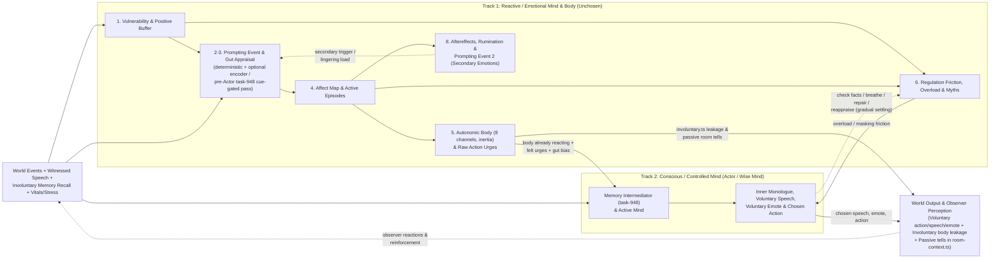
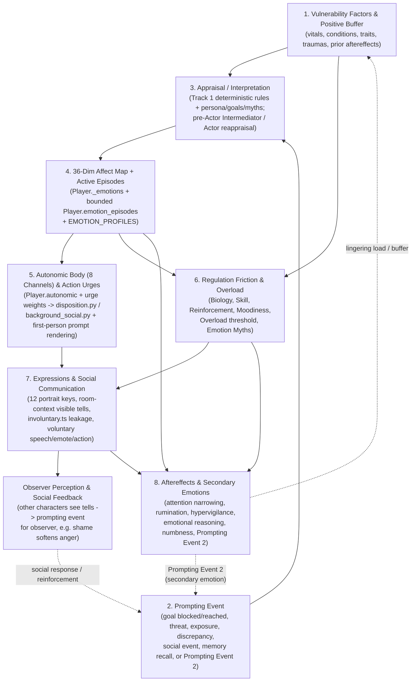

# Emotion System Redesign - Causal Affect Cycle & Optional Local Classifiers

**Status:** Design / pre-implementation (changes no code)
**Date:** 2026-11-21
**Grounded in:**
- `docs/virtualWorld/Simulation Philosophy.md`
- `docs/virtualWorld/Characters/Interiority & Subtext.md`
- `docs/virtualWorld/Characters/Emotion & Affect System.md`
- [Emotion & Mood - Whole-System Analysis](file:///f:/AI/viwo/virtual-world/docs/virtualWorld/Emotion%20%26%20Mood%20%E2%80%94%20Whole-System%20Analysis.md)
- `docs/design/person-data-model.md`
- `docs/virtualWorld/design/Character Pursuits.md`
- Marsha M. Linehan, *DBT Skills Training Handouts and Worksheets* (2nd ed., 2015): Emotion Regulation Handouts 3, 4, 5, 6 and Worksheets 2A, 4
- Lightweight local affective model evaluation (encoder text classifiers, continuous valence/arousal, facial/AU/scene vision models, small multimodal LLMs)

**Precedence:** Simulation Invariants > Grounded Realism > Authored Story Bibles > Engine Rules > Prompt Tuning.

---

## 1. Executive Summary

VirtualWorld already has a unified **36-dimension affect map** (`engine/emotion.py`), expression-portrait selection, memory-recall re-feel, multi-dimensional mood-congruent memory retrieval, and initial behavioral tilting in `engine/background_social.py` and `engine/disposition.py`.

What the current system lacks is **emotional causality and embodiment**. Today, affect is a stateless dictionary of 36 floats that get poked by events and linearly decay at `1.5` points per tick. It does not track *why* a feeling started, how physical vulnerability primed it, what bodily sensations and action urges it generates, how another character in the room can *see* it, why a character struggles to regulate it, how one emotion triggers a secondary emotion, or how unresolved feelings narrow attention and linger.

This document designs a layered upgrade combining three pillars:

1. **Dual-Track Parallel Mind & Coupled Emotional Matrix (DBT Handouts 3-6, Worksheets 2A & 4):** Separates **Track 1 (Reactive / Emotional Mind & Body, unchosen)** from **Track 2 (Conscious / Controlled Mind = Memory Intermediator + Actor)**. Instead of isolated single-emotion spikes (`"insult" -> angry +50`), incoming events, recalled memories, expectations, vitals, and prior mood flow through a **Coupled Emotional Matrix** across **13 core families** (the **10 DBT emotions** + VirtualWorld's **3 structural axes**: `calm`, `surprise`, `arousal`) producing simultaneous positive and negative shifts, a blended **8-channel Autonomic Body State** outside LLM control, competing urges, regulation friction, secondary emotions, and aftereffects.
2. **Continuous Embodied Context:** Feed autonomic body truth into the Actor's own prompt (`=== YOUR STATE ===`) and into observers' `room-context.ts` (`People here:`), reserving `involuntary.ts` for acute vocal/reflex breaks (voice catches, stutters, gasps, startle/freeze).
3. **Lightweight Local Affective Models (optional, pluggable):** Provides fast (2-10 ms), deterministic **expressed-emotion classification** for free text, memory tagging, continuous valence/arousal scoring, and authoring-time portrait/scene QA - without replacing deterministic simulation rules or subjective character appraisal.

**Non-negotiable architectural rule:** Keep `Player._emotions` (the 36-dimension map) as the **single continuous affect state** (with the 13-family Emotional Matrix operating cleanly over it as sub-shades). Do not add 170 numeric dimensions, do not build a second cognitive engine alongside MOSIAC/GIMP/Active Mind, do not spin up a third slow LLM pass per turn (piggyback semantic appraisal onto `task-948`'s cue-gated pre-Actor Intermediator), and never inject clinical DBT worksheet headers into LLM character prompts.

---

## 2. Measured Ground Truth (Current Codebase & Prerequisites)

All counts and defects below were verified directly against the live codebase (post-task-652, post-bug-587).

### 2.1 What Already Exists and Works

| Capability | Live Location | Measured State |
|---|---|---|
| Authoritative affect map | `engine/emotion.py:32-80`, `player.py:706-795` | **36** dimensions across **11** axes (`AXIS_TO_EXPRESSION`: 11 + `neutral` = **12** portrait keys). `Player.emotion` and `Player.emotion_intensity` are derived properties over `Player._emotions`. |
| LLM declared feeling bridge | `engine/emotion.py:769-815`, `routes/player_ops.py:60-124`, `static/js/agent-engine.ts:555-584` | `felt_from_llm()` resolves exact dims, `LABEL_TO_DIM` aliases, and optional semantic anchors without substring matching. |
| Self-recall & social-recall re-feel | `static/js/agent/prompt-builder/memory-context.ts`, `room-context.ts:183-222`, `routes/player_ops.py:127-239` | Surfacing or overhearing a memory re-spikes affect, nudges `VITAL_EFFECTS` (Sanity/Entertainment/Social), and nudges `RELATIONSHIP_VALENCE` via `engine/derive.py` when speaker is known. |
| Mood-congruent memory retrieval | `engine/memory_retrieval.py:593-723, :952-1048` | Channel 4 scores multi-dimensional affect vectors and target-bound (`who`/`why`) emotional memories. |
| Behavior tilting (soak/social) | `engine/background_social.py:252-310`, `engine/disposition.py:370-436` | `AFFECT_AFFINITY` tilts **8** social actions from **23** dimensions; `EMOTION_TILTS` tilts **8** disposition weights. |
| Fear detection & release | `engine/fear.py`, `engine/conditions.py:121-154`, `engine/background_social.py:1238-1776` | Tag-matched `fear_tags` apply/release source-bound `frightened`, flee/hide/freeze, and spike `afraid`. |
| Vitals fallback mood | `engine/emotion.py:468-531`, `player.py:873-890` | `derive_from_vitals()` generates a provisional mood when the explicit affect map is near-neutral. |
| Involuntary speech/emote flavor | `static/js/agent/involuntary.ts` | Splices stutter/shiver/cough/sneeze/ramble/yelp and flinch emotes from **8** conditions + `jittery` trait + startle flag. |

### 2.2 Seven Measured Cracks to Fix Before Layering New Mechanics (Phase 0)

1. **`set_dominant()` sibling-axis damping is a silent no-op and unclamped (`engine/emotion.py:436-440`):**
   `AXES` maps `dimension -> axis_name` (a string, e.g. `"afraid": "fear"`). `set_dominant()` runs `siblings = AXES.get(dimension, ())` and iterates `for other in siblings:`, which loops over single characters (`'f'`, `'e'`, `'a'`, `'r'`), none of which exist in `values`. Sibling dimensions on the same axis are never damped. In addition, `values[dimension] = BASELINES[dimension] + intensity * 100.0` is not clamped to `100.0` (e.g., `happy` at `1.0` writes `140.0`).
2. **Server/client `LABEL_TO_DIM` drift already exists:**
   `engine/emotion.py:155-185` declares **78** keys; `static/js/shared/emotion-mapper.ts:37-58` declares **70** keys (**8 missing axis aliases**: `anger`, `arousal`, `bond`, `disgust`, `envy`, `sadness`, `shame`, `surprise`). The client mapper also still performs substring fallback (`emotion-mapper.ts:129-131`), which task-652 deliberately removed from `felt_from_llm()`.
3. **22 of 36 dimensions have no hand-written `_BANDS` prose (`engine/emotion.py:213-287`):**
   Only **14** dimensions have crafted text (`happy`, `sad`, `afraid`, `angry`, `envious`, `affectionate`, `disgusted`, `calm`, `lonely`, `craving`, `anxious`, `uneasy`, `irritated`, `melancholic`). The remaining **22** - including `ashamed`, `embarrassed`, `guilty`, `jealous`, `loving`, `resentful`, `dread`, `spooked`, `proud`, `repulsed`, `surprised` - fall back to `_generic_bands()`: `"You feel <key> with unusual intensity."`, which reads like debug telemetry and violates `Interiority & Subtext.md`.
4. **`Player._FELT_TO_DIM` (`player.py:814-826`) silently drops 25+ dimensions on `toward` spikes (`routes/player_ops.py:75-93`):**
   When an LLM declares a feeling directed at a known person (e.g., `{"label": "guilty", "intensity": 7, "toward": "Rosa"}`, or `ashamed`, `jealous`, `loving`, `sad`, `resentful`, `embarrassed`), `routes/player_ops.py:79` narrows `valid` to the **11** keys in `Player._FELT_TO_DIM`. When `felt_from_llm()` resolves `"guilty"` -> `"guilty"`, line 92 rejects it and returns `ignored`, dropping both the relationship record and the affect map spike.
5. **`RELATIONSHIP_VALENCE` assigns positive trust to shame and guilt (`engine/emotion.py:202`):**
   `ashamed`, `embarrassed`, and `guilty` all map to `("trust", +0.3)`. Outside playful/intimate flustering, feeling ashamed or guilty toward someone does not unconditionally increase trust in them.
6. **Other characters' emotions are invisible in room perception (`static/js/agent/prompt-builder/room-context.ts:832-862`):**
   `People here:` displays name/alias, relationship label, state, activity, spatial position, first sentence of description, and worn/held items. It renders **zero** observable facial expression, posture, or physical tell from the other character's affect map. Likewise, `static/js/agent/involuntary.ts` reads conditions and `jittery`, never the affect map.
7. **Uniform decay and uncoupled vitals/traits:**
   `emotion.decay()` (`engine/emotion.py:444-455`) subtracts a flat `1.5/tick` from every dimension regardless of whether the emotion is fleeting (`surprised`) or sticky (`resentful`, `ashamed`, `sad`). `data/library/traits/apathetic.json` states `"Emotional intensity drifts to neutral faster"` in its description, but its `effects` object only sets `{"no_entertainment_decay": true}`. Vitals only enter via `derive_from_vitals()` as a fallback when explicit affect is silent (`player.py:882-890`), never as a reactivity or regulation modifier.

---

## 3. Design Principles & Boundaries (What to Adopt vs. What to Reject)

### 3.1 From the DBT Handouts

| Adopt into Engine & Mind UI | Reject / Adapt for VirtualWorld |
|---|---|
| **Causal feedback loop (Handout 5):** Vulnerability -> Prompting Event -> Interpretation -> Somatic Changes + Action Urges <-> Expressions -> Awareness -> Secondary Emotions & Aftereffects. | **Never put DBT worksheet headers in LLM prompts.** Per `Interiority & Subtext.md`, prompts carry embodied sensations, urges, and associative subtext - never `"Vulnerability Factors:"` or `"Action Urge:"`. Keep Worksheet 4's structured trace strictly for the Mind Inspector UI (`mind-view.ts`). |
| **Functional separation of Shame vs. Guilt and Envy vs. Jealousy (Handout 6):** Distinct somatic cues, opposite action urges (hide vs. repair; acquire/undermine vs. cling/control/guard), distinct aftereffects. | **Do not collapse 36 dimensions into 10, and do not create 170 float dimensions.** Keep the 36-dimension map and 11/12 portrait keys; put the ~170 Handout 6 words into curated `LABEL_TO_DIM` + intensity/somatic phrasing, and encode family behavior in `EMOTION_PROFILES`. |
| **Three functions of emotion (Handout 3):** Motivate action (urges), communicate to/influence others (involuntary tells + observer feedback), communicate to self (gut signals + **emotional reasoning** bias). | **Strip modern clinical/therapy framing.** Replace "Wise Mind" with character composure/personal code/clear-headedness; replace "joining self-help programs" with world-appropriate vows, amends, or habit changes across medieval, goblin, sci-fi, and domestic settings. |
| **Six regulation friction factors (Handout 4):** Biology, lack of skill, environmental reinforcement, moodiness, emotional overload (skills breakdown point), emotion myths. | **Do not force scripted emotional arcs.** Emotions tilt weights, alter perception/attention, leak through tells, and create friction; characters still make grounded choices under simulation invariants. |

### 3.2 From Lightweight Local Emotion Models

The foundational boundary is **Expressed Emotion != Evoked Appraisal**:

- **Expressed emotion** ("what feeling is present in this text or on this face?") is a surface classification problem. Tiny local encoders (30M-150M params, ~2-10 ms on CPU/ONNX) beat full LLMs on speed, determinism, cost, and zero JSON-parsing failures.
- **Evoked appraisal** ("how does *this* specific character react to what just happened?") is deeply subjective and state-dependent. The line *"You left the back door unlocked"* has neutral surface sentiment, yet triggers dread in a character with home-invasion trauma, fury in a controlling parent, and guilt in a forgetful teen. A generic surface-tone classifier **cannot** decide evoked character emotion on its own; that belongs to deterministic appraisal rules (soak/background) and the character's LLM turn (attended), conditioned on `persona`, `goals`, `relationships`, `memories`, and `vulnerability_load`.

Therefore:
- **Every local ML model is optional and pluggable** (default `"none"`, zero hard dependency for core engine or unit tests, matching `emotion.semantic_labels` in `engine/emotion.py:634-642`).
- **Never put vision or 0.5B-7B LLM inference inside the per-tick simulation loop.**

---

## 4. Target Architecture: Dual-Track Mind & The DBT Emotion Cycle

### 4.1 The Dual-Track Parallel Mind (Reactive Mind vs. Controlled Mind)

A core limitation of single-call LLM agents is that the **same** conscious decision step chooses both *"what I feel"* and *"what I say and do."* Real human interiority has real friction because **two parallel tracks** operate at once:

1. **Track 1 - The Reactive / Emotional Mind & Body (Fast, Automatic, Unchosen):**
   - Watches incoming world observations, spoken lines, bodily vitals (`Hunger`, `Energy`, `Temperature`, `HP`, `Sanity`), and involuntary memory recall (`engine/memory_retrieval.py`) **in parallel** with conscious thought.
   - Runs **before** the Actor LLM wakes up, without asking its permission.
   - Produces: automatic gut interpretation (colored by hunger, exhaustion, stress, past recalled memories, fears/traumas, and emotion myths), emotion spikes, involuntary autonomic body state (Section 5.5), and raw action urges.
   - **Three-speed implementation (avoiding a 3rd slow LLM pass):**
     - *Layer 1A (0 ms, always on, pure Python):* Deterministic appraisal over vitals, fear/trauma tags, goals/obligations, exposure, memory-recall re-feel, and autonomic physics. Identical across soak, simple NPCs, humans, and attended agents.
     - *Layer 1B (optional, ~3-10 ms, local encoder):* `GLiClass` / `NPC-Valence-Arousal` detects surface tone in incoming speech/events.
     - *Layer 1C (attended turns only, piggybacked on `task-948` `getMemoryLLMClient()`):* VirtualWorld already plans a cue-gated **Memory Intermediator** (`task-948`, `task-909`) sitting between sensory observations/involuntary recall and Actor planning. Folding nuanced social-subtext appraisal into that exact pre-Actor synthesis stage lets the character's Reactive Mind interpret subtle slights or loaded silence **before** the Actor LLM runs - without adding a separate third LLM call per turn.

2. **Track 2 - The Conscious / Controlled Mind ("Wise Mind" / Active Actor):**
   - Runs conscious recollection synthesis (`task-948`), `inner_monologue`, deliberate action choice, voluntary `speech`, and voluntary `emote`.
   - Wakes up **already inside** the body and gut state Track 1 generated.
   - Retains full freedom to choose voluntary speech and emotes (playing it cool, cracking a joke, walking away, apologizing, asking a clarifying question) - while Track 1 still owns involuntary physical leakage (`involuntary.ts`) and passive body tells visible to observers (`room-context.ts`).
   - **Downward regulation (Track 2 pushing back on Track 1):** Conscious mind cannot click a magic *"set fear = 0"* button. It regulates Track 1 through real in-world and cognitive acts - breathing/resting, leaving the room, eating/warming up, checking the facts in dialogue, making amends, or conscious reappraisal - which mark episodes `resolved: true` and let autonomic inertia unwind over ticks.



### 4.2 The Emotional Matrix (Coupled Multi-Emotion State Transition)

Isolated single-emotion spikes (`"Jake insulted you" -> spike("angry", +50)`) break emotional realism. A real emotional event shifts the **entire coupled emotional state** at once - raising some emotions, suppressing others (reducing `love` and `happiness`), and blending multiple bodily responses simultaneously based on **who** acted, **where** it happened, **who witnessed it**, **recalled memories**, **expectations**, **prior moodiness**, and **regulation friction**.

The **Emotional Matrix** models every emotional update as a holistic state transition over the **13 core families** (the **10 DBT emotions**: `anger`, `disgust`, `envy`, `fear`, `happiness`, `jealousy`, `love`, `sadness`, `shame`, `guilt`, plus VirtualWorld's **3 structural axes**: `calm`, `surprise`, `arousal`):

```text
Inputs:
  e(t-1)       current affect vector (prior mood & moodiness momentum)
  world_event  what happened, who did/said it, where, witnesses (observation_signal)
  memories     recalled memories about that person/place/pattern (memory_retrieval.py)
  expectations Active Mind assumptions & obligations (task-944 / task-957)
  body_state   vitals, conditions, current autonomic channels (vulnerability_load)
  regulation   WIS/skill, reinforcement history, traits/memories/witnesses, overload state

Step 1 - Contextual Delta Vector (raw_delta across all 13 families, signed +/-):
  - Default Track 1 (all listeners & soak NPCs): Tier 1 deterministic structural guards
    + lightweight local CPU emotion classifier (`cirimus/modernbert-base-go-emotions`,
    ~72 ms CPU, 0 VRAM, 0 generative LLM calls; optional `knowledgator/gliclass-edge-v3.0`
    at ~22 ms CPU for high-volume soak).
  - Optional spotlight subtext: qualitative intensity bands (`slight/mild/moderate/strong`,
    never raw numbers) piggybacked onto `task-948`'s existing Memory Intermediator for the
    active speaker only (0 new LLM calls).

Step 2 - Coupled Matrix Transfer (deterministic pure Python, 0 ms):
  1. Vulnerability & Positive Buffer scaling:
       negative deltas scaled by (1 + vulnerability_load * amp);
       minor negative deltas cushioned by positive_buffer unless trust/expectation breached.
  2. Moodiness & Prior-State Bias:
       existing mood tilts how incoming deltas land (e.g., pre-existing shame/sadness
       turns a slight inward; pre-existing irritation/pride turns the same slight outward).
  3. Cross-Emotion Coupling Matrix W (sparse 13x13):
       surging anger/fear/disgust/shame/sadness suppresses happiness and calm;
       surging anger/disgust toward a bond erodes live love while raising hurt/sadness;
       surging jealousy co-activates fear and anger;
       trait, memory, or public-witness conflicts fire Prompting Event 2 secondary deltas.
  4. Overload & Regulation Check:
       compare peak arousal against regulation_capacity (Biology, Skill, Reinforcement,
       Moodiness, Traits).

Step 3 - Unified Downstream Output (all driven by the COMBINED vector e(t)):
  - Blended 8-channel Autonomic Body State: weighted sum across ALL raised families
    (e.g., anger + sadness + shame -> hot face + tight jaw + stinging tears + hollow gut).
  - New Mood & Cognitive Lens: feeds Channel 4 memory retrieval, MOSIAC attention
    narrowing, emotional reasoning bias, and the next turn's e(t-1).
  - Multi-Directional Action Urges: simultaneous competing impulses (e.g. lash out AND
    shrink back) rendered as urges to the Actor and additive tilts to disposition.py.
```

**Why 13 Matrix families over the 36-dim map works cleanly:** The Pre-Actor Limbic Appraiser, the sparse 13x13 coupling matrix `W`, and the Mind UI default view only need to reason over the **10 DBT + 3 ViWo families** (compact, inspectable, and easy for small local models to output reliably), while `Player._emotions` continues storing the existing 36 dimensions as fine-grained sub-shades (`lonely` inside `sadness`, `anxious` inside `fear`, `embarrassed` inside `shame`, `craving`/`curious` inside `arousal`) with zero save migration.

### 4.3 Detailed DBT Causal Cycle



---

## 5. Stage-by-Stage Specification

### 5.1 Stage 1: Vulnerability Factors and Positive Buffer

Instead of using `vitals` only when the affect map is silent (`player.py:882-890`), compute two derived, unstored scalars on read from existing character state:

- **`vulnerability_load` (`0.0` to `1.0`)**: Aggregated from existing physiological and psychological stressors:
  - Drives past concern thresholds (`Hunger >= 70`, `Thirst >= 70`, `Bladder >= 70`).
  - Depleted resources (`Energy <= 30`, `Sanity <= 35`, `Social <= 25`, `HP < 60%`).
  - Thermal discomfort (using species-aware temperature bands when available rather than hardcoded 35/38, addressing the open note in `task-142`).
  - Active debilitating conditions (`sick`, `poisoned`, `hypothermia`, `social_breakdown`, `frightened`).
  - Lingering negative aftereffects (e.g., active rumination or post-overload exhaustion).
- **`positive_buffer` (`0.0` to `1.0`)**: Derived from raised positive/stabilizing dimensions (`happy`, `content`, `peaceful`, `loving`, `satisfied`, `grateful`) above baseline.

**Mechanical effects:**
1. **Negative reactivity scaling:** Incoming negative spikes scale by `1.0 + vulnerability_load * emotion.vulnerability_amp` (e.g. default `0.45`, so an exhausted, starving character takes up to `1.45x` impact from the same frustration or slight).
2. **Annoyance/worry threshold (Handout 6 Happiness aftereffect):** When `positive_buffer > 0`, minor negative spikes below a small cushion (`positive_buffer * emotion.buffer_damp_max`) are attenuated. Strong real threats still punch straight through.
3. **Regulation drain:** `vulnerability_load` directly lowers `regulation_capacity` (Section 5.6).
4. **Ambient fallback preserved:** `derive_from_vitals()` continues to fill the silence when no explicit emotion is raised above `SPEAK_THRESHOLD`.

### 5.2 Stage 2: Prompting Events & The Bounded Episode Trace

To give emotions real causality without duplicating `Player.memories`, introduce a lightweight bounded list on `Player`: **`emotion_episodes`** (max 6 active/recent entries, pruned automatically once the episode's dimension decays near baseline and `resolved` is true).

```json
{
  "id": "ep_179_1",
  "tick": 179,
  "dimension": "ashamed",
  "family": "shame",
  "peak_delta": 42.0,
  "prompting_event": {
    "kind": "social",
    "summary": "hid destroying Rosa's pot instead of admitting it",
    "source_id": "player_rosa",
    "memory_id": "mem_179_04"
  },
  "appraisal": "violated personal honesty standard and feared rejection",
  "urges": ["hide", "withdraw", "appease"],
  "secondary_of": null,
  "suppressed": true,
  "resolved": false,
  "rumination_ticks": 3
}
```

**Six Prompting Event sources (all wired from existing ViWo systems):**

| Source | Existing Producer | Primary Dimensions Triggered |
|---|---|---|
| **Goal & Obligation lifecycle** | `engine/goals.py`, `engine/mosiac.py` | Blocked goal -> `irritated` / `angry`; missed deadline or dropped high-priority goal -> `sad` / `ashamed`; goal reached -> `happy` / `proud` / `elated`; failed obligation -> `guilty`; fulfilled obligation -> `satisfied` / `proud`. |
| **Prediction error / Discrepancy** | `task-957` (Active Mind expectation vs. observation) | Mismatch -> `surprised` + follow-on appraisal (`afraid` if threat, `angry` if betrayal, `sad` if loss). |
| **Threat, Contamination & Exposure** | `engine/fear.py`, `engine/character_appearance.py` (`affect_for_stimulus`), `engine/observation_signal.py` | `fear_tags` / `traumas` match -> `afraid` / `dread` / `spooked`; `turn_offs` / blood / corpse / spoiled food -> `disgusted` / `repulsed`; unwanted public exposure (`observation_signal` public audience + `prudish` or boundary violation) -> `embarrassed` / `ashamed` (or `aroused` for `exhibitionist`). |
| **Interpersonal & Social** | `engine/background_social.py`, `turn_events`, speech | Insult/bullying/unfairness -> `angry` / `resentful`; praise/kindness/shared fun -> `happy` / `grateful` / `loving`; watching someone hold an item/status matching own `goal`/`aspiration` -> `envious`; watching a rival engage a close bond (`closeness >= 50` or `loving`/`affectionate`) or partner withdrawing -> `jealous`; hurting/betraying a valued person -> `guilty`. |
| **Memory Recall (self & social)** | `memory-context.ts`, `room-context.ts` (`/emotions/map`) | Re-felt memory emotions record `prompting_event.kind = "memory"` and `memory_id`, letting the Mind Inspector trace "out of nowhere" feelings back to the exact recalled memory. |
| **Prompting Event 2 (Secondary Emotion)** | `engine/emotion.py` secondary-transition evaluator | An active primary emotion crosses a character's emotion myth, value boundary, or public composure breach -> emits a child episode with `secondary_of = parent.id`. |

High-importance episodes (`peak_delta >= threshold` or unresolved major trauma/betrayal) can promote into `Player.memories` through the existing memory pipeline (`engine/lived_log_memory.py` / `task-725`) rather than acting as a permanent parallel memory archive.

### 5.3 Stage 3: Appraisal / Interpretation (Deterministic + Subjective Tiers)

The same prompting event lands differently depending on *who* the character is:

- **Deterministic tier (soak, background, simple NPC, pre-turn baseline):**
  - Reads existing authored data only (`persona.personality`: `fears`, `traumas`, `likes`, `dislikes`, `boundaries`, `traits`; `Player.goals`; `Player.memories`; `engine/derive.py` profile for `source_id`).
  - Applies **mood-congruent appraisal bias** from active aftereffects:
    - Active `jealous` or `afraid`/`anxious` shifts ambiguous social events toward suspicion/threat.
    - Active `angry`/`resentful` shifts blocked actions toward blame ("unfair / intentional").
    - Active `loving` discounts minor flaws ("seeing the positive side").
    - Active `ashamed` shifts neutral silence/correction toward perceived rejection.
- **Subjective LLM tier (attended turns):**
  - The LLM continues to reason freely in `inner_monologue` and declare structured `emotion` impulses (`{label, intensity, toward?, cause?}`).
  - Fixing `routes/player_ops.py:75-93` separates two concerns that are currently conflated:
    1. **Affect map spike:** Always resolved through `felt_from_llm()` across all 36 dimensions (never dropped just because `toward` was supplied).
    2. **Relationship drive record:** When `toward` resolves to a known person, map via an expanded full-36-dimension table (unified with `RELATIONSHIP_VALENCE`, not the stale 11-entry `Player._FELT_TO_DIM`).
  - Adding an optional short `"cause"` (or `"why"`) field to the `emotion` impulse allows the LLM's own appraisal to populate `emotion_episodes[].appraisal` cleanly, without forcing extra LLM calls.

### 5.4 Stage 4: `EMOTION_PROFILES` - Completing the 36 Dimensions

Rather than altering the 36 dimension keys or breaking the 12-slot expression pack, add a declarative registry `EMOTION_PROFILES` in `engine/emotion.py` (one entry per dimension, or inherited from a **14-family** psychological table that splits DBT's key pairs while preserving `AXIS_TO_EXPRESSION` for art):

| Psychological Family | Dimensions in `BASELINES` | Portrait Key (`AXIS_TO_EXPRESSION`) | Relative Decay Rate | Distinct Action Urges | Core Aftereffects |
|---|---|---|---|---|---|
| `anger` | `angry`, `irritated`, `resentful` | `angry` | `angry` 1.3, `irritated` 1.8, `resentful` 0.5 | confront, attack, shout, criticize, slam/leave, brood | attention narrowing, rumination, future-conflict rehearsal, numbness at peak |
| `disgust` | `disgusted`, `repulsed` | `disgusted` | `1.4` | recoil, wash/clean, avoid eating/drinking, push away, scorn | attention narrowing, contamination hypersensitivity, rumination |
| `envy` | `envious` | `envious` | `0.7` | acquire, work harder, devalue/sabotage rival's prize, avoid envied person | discounting what you have, comparison rumination, resolution to change |
| `jealousy` *(split from envy)* | `jealous` | `envious` *(or optional new slot)* | `0.6` | cling/possess, interrogate, watch/spy, control, confront rival | broad mistrust, relationship hypervigilance, isolation |
| `fear` | `afraid`, `anxious`, `uneasy`, `dread`, `spooked` | `afraid` | `spooked` 2.6, `afraid` 1.4, `anxious` 1.0, `uneasy` 1.3, `dread` 0.6 | flee, hide, freeze, plead for help, talk self out of risk | hypervigilance, tunnel vision, disorientation/loss of focus, isolating |
| `joy` | `happy`, `excited`, `elated`, `proud` | `happy` | `excited`/`elated` 1.8, `happy` 1.2, `proud` 0.9 | share feeling, engage/help, keep doing what brought joy, celebrate | higher annoyance/worry threshold, positive recall bias, courtesy |
| `bond` / `love` | `affectionate`, `loving`, `grateful`, `admiring` | `affectionate` | `grateful`/`admiring` 1.1, `affectionate` 0.8, `loving` 0.4 | seek closeness/touch, give gifts, do what they need, express fondness | seeing only positive side, trust/openness, distraction/daydreaming, confidence |
| `sadness` | `sad`, `lonely`, `melancholic`, `nostalgic` | `sad` | `sad` 0.7, `lonely` 0.6, `melancholic` 0.6, `nostalgic` 1.1 | withdraw, go inactive/rest, seek comfort/confide, give up effort | inability to recall happy memories, rumination, irritability, sleep/appetite drag |
| `shame` *(split from guilt)* | `ashamed`, `embarrassed` | `ashamed` | `embarrassed` 2.0, `ashamed` 0.6 | shrink/hide, cover face, avoid critic/harmed person, appease, deflect/blame | self-preoccupation, shutting down/numbness, impulsive distraction, impaired problem-solving |
| `guilt` *(split from shame)* | `guilty` | `ashamed` *(or optional new slot)* | `0.7` | repair harm, confess, apologize, give gift/sacrifice to make amends | resolution to change behavior, concrete corrective action |
| `arousal` | `aroused`, `eager`, `craving`, `curious` | `aroused` | `aroused` 1.6, `eager`/`curious` 1.5, `craving` 1.0 | pursue object of desire/interest, examine, approach | narrowed focus onto object of desire/curiosity |
| `calm` | `calm`, `content`, `peaceful`, `satisfied` | `calm` | `1.0` | rest, maintain equilibrium, deliberate clearly | buffers minor spikes, restores `regulation_capacity` |
| `surprise` | `surprised` | `surprised` | `3.2` | orient attention toward discrepancy, pause, examine | brief heightened alertness; hands off to follow-on appraisal |

**Key structural fixes included in `EMOTION_PROFILES`:**
- **36/36 hand-written `_BANDS`** (closing the 22 generic debug fallbacks), each written in embodied somatic + felt-urge prose and respecting state/species (e.g., dead/ghost characters never receive pulsing-blood or sweating somatic lines).
- **Curated `LABEL_TO_DIM` expansion (~78 -> ~170+ words):** Incorporates DBT Handout 6's 10 word banks plus the 9 "Other Important Emotion Words" clusters (`weary`, `distressed`, `shy`, `bashful`, `cautious`, `wary`, `suspicious`, `awed`, `startled`, `bold`, `determined`, `capable`, `dubious`, `skeptical`, `apathetic`, `bored`, `listless`, `indifferent`, `remorseful`, `humiliated`, `mortified`, `possessive`, `covetous`, `indignant`, `outraged`, `vengeful`, `contemptuous`, `scornful`, `loathing`, `devastated`, `grieving`, `anguished`, `despairing`, `tender`, `fond`, `infatuated`, `euphoric`, `relieved`, etc.).
- **Single source of truth for client/server vocabulary:** Export `LABEL_TO_DIM` and `DIM_ANCHORS` from `engine/emotion.py` (either via a generated TS artifact or `GET /api/meta/emotions`) and enforce exact parity in `tests/test_affect_model.py`, removing the client substring fallback.
- **Unified behavior tilting:** `engine/disposition.py` (`EMOTION_TILTS`) and `engine/background_social.py` (`AFFECT_AFFINITY`) read their urge mappings from `EMOTION_PROFILES` so `guilty` tilts `apologise`/`repair`, `ashamed` tilts `withdraw`/`ignore`/`hide` (NOT `trust+`), `jealous` tilts `interrogate`/`watch`/`cling`/`bully`, `envious` tilts `compete`/`criticize`, and `disgusted` tilts `avoid`/`leave`/`wash`.

### 5.5 Stage 5: The Autonomic / Involuntary Body Layer (Outside LLM Control)

DBT Handout 5 places **Biological Changes** (*nervous system firing - muscles, blood vessels, heart rate, temperature*) and **Body Sensations / Action Urges** between appraisal and voluntary expression. Today, VirtualWorld has scattered pieces of this layer - `blushing` (`engine/player_conditions.py:376`, currently stranded under `mature_content`), `goosebumps` (`:495`), `VISIBLE_BODY_STATE_PHRASES` (`engine/equipment.py:140`, gated on `mature_content`), and `static/js/agent/involuntary.ts` (reading only 8 condition IDs + `jittery`) - with no unifying autonomic model.

As a result, an LLM can currently declare `speech: "I'm fine"`, `emote: "smiles calmly"` while terrified or furious, and the character's body instantly obeys. That breaks `Simulation Philosophy.md` Invariant #2 (*"involuntary tells (blushing, heart palpitations, freezing, trembling)"*).

#### 5.5.1 Eight Non-Voluntary Autonomic Channels (`Player.autonomic`)

Audited line-by-line against every biological reaction across all **10 DBT Handout 6 sheets** (Anger, Disgust, Envy, Fear, Happiness, Jealousy, Love, Sadness, Shame, Guilt). Model a compact, engine-owned physiological state on living characters (**8 channels**, `0..100` or signed `-100..+100`, persisted alongside vitals with its own **physiological inertia** - adrenaline, flushing, nausea, and exhaustion do not vanish in one tick just because a character changes topic):

| Channel | Scale & Polarity | Handout 6 Biological Reactions Covered | Driven By (Emotions + Physics) | Out-of-LLM-Control Effects |
|---|---|---|---|---|
| **Heart rate / Adrenaline** | `0` (resting) .. `100` (pounding) | Fast heartbeat, pounding pulse, feeling like you are going to explode, jitteriness | `fear`, `anger`, `jealousy`, `love`/excitement, `guilt`, `surprise`, plus `dash`/combat exertion. Slow decay (adrenaline hangover). | Interoceptive pounding sensation; feeds `Emotional Overload`; drains `Energy` slightly on crash. |
| **Breathing** | `0` (steady) .. `100` (gasping / choking) | Breathlessness, choking sensation, suffocating chest, difficulty catching breath | `fear`, `jealousy`, `guilt` (suffocating), `sad` (sobbing), exertion. | Voice catch / breathless cadence / speechless pauses in `involuntary.ts`; short-breath tell to observers; hampers `Stealth` / `Persuasion` at peak. |
| **Muscle tension** | `0` (relaxed) .. `100` (clenched / trembling) | Muscles tightening/cramping, teeth clamping, jaw/mouth tightening, hands clenching into fists, rigidity, shaking/quivering/trembling | `anger`, `envy`, `fear`, `jealousy`, `shame`, active emotion suppression (`suppressed: true`). | Involuntary jaw clamp, rigid shoulders, fists tightening at sides, and **hand tremor** at high tension (real DEX / `Sleight of Hand` / ranged-aim friction). |
| **Vasomotor (Flush / Pallor)** | `-100` (pale/cold) .. `0` .. `+100` (hot/red/flushed) | Face flushing or getting hot, red face, glowing warmth (`+`); getting cold, blood draining (`-`) | Positive (`+`): `anger`, `envy`, `guilt`, `shame`/`embarrassed`, `happiness`, `love`, `aroused`, heat. Negative (`-`): `fear`, shock, `disgust`, cold. | Un-gates `blushing` from `mature_content`; visibly reddens cheeks/ears/neck (`+`) or drains face pale (`-`) in `room-context.ts` even when `emote` is `null`. |
| **Sweat & Chills (Skin/Piloerection)** | `-100` (chills/hair erect) .. `0` .. `+100` (clammy/sweating) | Feeling cold/clammy, sweating/perspiring, hairs standing on end, skin crawling / feeling contaminated | `fear` (clammy sweat, hair erect), `disgust` (skin crawling/unclean), `guilt`/`anxious` (nervous sweat), ambient cold (`goosebumps`). | Syncs with existing `goosebumps` condition (`player_conditions.py:495`); visible clammy sheen / shuddering / raised hackles (for animals). |
| **Gut & Throat (Digestive/Nausea)** | `0` (settled) .. `100` (knotted / nauseous / gagging) | Pit in stomach, butterflies, hollowness in chest/gut, lump in throat, difficulty swallowing, nausea, gagging/vomiting, aversion to eating/drinking, indigestion | `disgust` (nausea, gagging, food aversion), `shame` (stomach pit), `envy` (stomach pit), `fear` (butterflies, lump, nausea), `sadness` (hollow gut, difficulty swallowing, appetite loss). | Halting/cracking voice in `involuntary.ts`; suppresses appetite / makes food unappealing (extreme `disgust`/`fear` can trigger gag/vomit tells); somatic dread/hollowness in prompts. |
| **Motor Tone & Energy Posture** | `-100` (slumped/dizzy/faint) .. `0` .. `+100` (buoyant/energetic) | Heavy/tired/lethargic/listless, slumping posture, shrinking down, slow shuffling, dizziness, fainting (`-`); frozen immobile (combined with high `muscle_tension`); physically energetic, bouncy, open/expansive (`+`) | Positive (`+`): `happiness`, `love`, `excited`. Negative (`-`): `sadness` (heavy, dizzy), `shame` (shrinking, sinking back), extreme `disgust` (fainting), low `Energy`/sleep deprivation. | Slumped/shrunk or buoyant/open posture visible in `room-context.ts`; slows movement speed slightly under heavy grief/exhaustion; extreme `disgust`/shock fainting risk. |
| **Eyes & Tears** | `0` (steady/dry) .. `100` (stinging / spilling) | Being unable to stop tears, crying/sobbing/whimpering, eyes drooping, darting eyes, frozen stare, looking down and away | `sad` (unstoppable tears, drooping), peak `anger` (angry tears), `shame` (averted gaze), `fear` (darting/frozen stare), overwhelming joy/relief, pain. | Watery eyes / blinking fast / tears spilling / averted or darting gaze in `room-context.ts` and `involuntary.ts`, regardless of whether the character wants to cry or hold eye contact. |

#### 5.5.2 Why This Layer Is Strictly Outside LLM Control

1. **Pre-turn body reality (`=== YOUR STATE ===`):** Before the LLM chooses what to think or say, the prompt reports what the body is *already* doing (*"Your heart is hammering hard against your ribs, heat is climbing your neck, and your hands have tightened into fists without you meaning to."*). The LLM can choose how to *respond* (hide hands in pockets, try to breathe, walk out, snap), but it cannot retroactively pretend the body is calm.
2. **Clean separation between room-context body truth and `involuntary.ts`:**
   - **Continuous physical tells live in prompts and room context, NOT regex-appended emote suffixes:** Feeding the character's live autonomic state directly into their own turn context (`=== YOUR STATE ===`) lets the Actor naturally weave body cues into its own writing without fighting or duplicating its emote text. Feeding the same autonomic state into other characters' `room-context.ts` (`People here:`) guarantees observers see flushed necks, clenched fists, pale skin, or trembling hands even if the Actor tries to play calm or emits `emote: null`.
   - **`static/js/agent/involuntary.ts` stays focused on acute vocal/reflex interruptions:** Stutters, voice catches, gasps, sobs, coughs, shivers, sneezes, and startle/freeze shocks that physically break into speech cadence or reflex beats when an autonomic channel crosses overload or acute shock.
3. **Passive visibility even on silent turns (`room-context.ts`):** Because autonomic state lives in the engine, observers in the room see flushed ears, white knuckles, pale clammy skin, trembling hands, or glossy eyes even if the character emits `emote: null` and `speech: null`.
4. **Interoceptive feedback (bidirectional arrows in Handout 5):** Physical exertion (`dash`, combat), cold (`Temperature`), hunger crashes, or pain drive the *exact same* autonomic channels. A character who just sprinted away or has low blood sugar enters a conversation already breathless with an elevated pulse, raising `vulnerability_load` and priming anxious/irritable appraisals until their body settles.
5. **Species-aware autonomic profiles:** Driven by `engine/species.py` and `player.state`:
   - `dead` / undead / constructs: autonomic layer disabled (no pulse, flush, or trembling).
   - Warm-blooded mammals / humanoids: full 8 channels.
   - Animals / non-humanoids: map channels to species tells (hackles raised / `hair erect`, ears pinned, tail tucked, panting) instead of human cheek-blushing.
6. **Human characters - Embodied vs. Director-Override toggle:** Human-controlled characters run the same Track 1 Emotional Matrix and autonomic body layer (showing bodily sensations in the turn panel and exposing passive tells like flushing, breathlessness, or tense posture to watching NPCs, while never silently rewriting typed dialogue unless an incapacitating condition is active). Two configurable play modes match existing Director controls:
   - **Embodied mode (default for immersion):** The player cannot click away their character's involuntary flush, pulse, or gut drop; they play through or regulate it in-world.
   - **Director / Adjustable mode (optional toggle):** The player can inspect and adjust Track 1's emotion shifts before committing a turn, mirroring Director edits.

#### 5.5.3 Action Urges (Interiority Translation)

Per `docs/virtualWorld/Characters/Interiority & Subtext.md`, **action urges are felt impulses, never forced commands:**
- In **LLM prompts** (`buildEmotionContext`), the engine renders at most the **top 2 deviant dimensions** (preserving the existing N4 brevity rule in `engine/emotion.py:537`), weaving the active autonomic sensations together with the felt action urge (and suppression/overload friction when active).
- In **soak / background / disposition** (`engine/disposition.py`, `engine/background_social.py`), urges remain **additive/multiplicative tilts** (never overriding hard relationship or capability gates, preserving task-652's design invariant).

### 5.6 Stage 6: Regulation Friction, Overload & Emotion Myths (Handout 4)

Model why a character *can* or *cannot* keep their composure using the six DBT friction factors, mapped cleanly onto existing character data:

| DBT Factor (Handout 4) | VirtualWorld Source | Mechanical Role |
|---|---|---|
| **1. Biology** | `vulnerability_load` (vitals, conditions, species) | Drains `regulation_capacity`; amplifies negative spikes. |
| **2. Lack of Skill** | `stats.WIS` + coping/composure traits (e.g., `patient`, `stoic`, `composed` vs. `impulsive`, `jittery`, `volatile`) | Sets baseline `regulation_capacity` (e.g. `40 + (WIS - 10) * 3 + trait_bonus`, clamped `15..95`). |
| **3. Reinforcement of Emotional Behavior** | Past high-emotion memories (`Player.memories`) whose outcome coincided with goal progress or social compliance | Raises urge tilt and slows spontaneous self-regulation for the reinforced family (characters who learned that blowing up gets compliance keep blowing up). |
| **4. Moodiness (State resistance)** | Episode persistence (`rumination_ticks`) + current mood momentum | Once a negative episode entrenches, active resistance to calming increases; casual soothing lines from low-trust others have reduced effect or backfire into `irritated`. |
| **5. Emotional Overload (Skills breakdown point)** | `peak_arousal > regulation_capacity` | Crosses into transient **overloaded** state: masking fails (involuntary tells fire freely), deliberate skill checks (`Persuasion`, `Deception`, `Investigation`) take a composure penalty, urge weights strengthen, and prompt adds overwhelm sensation. |
| **6. Secondary Emotion & Suppression Dynamics** | Existing `persona.personality` (`traits`, `fears`, `traumas`), recalled `Player.memories`, and `event.witnesses` (no separate myth-slug field) | Composed/stoic/guarded traits and public `witnesses` drive expression suppression (masking tells at a Sanity/tension cost) and trigger **Prompting Event 2** secondary emotions (`afraid` -> `ashamed`/`angry`). Honest/guilt-prone temperament or family-expectation memories turn cover lies or sharp outbursts into `guilty`. Protective/stubborn/vigilant traits and unresolved high-stakes episodes resist quick calming and slow decay on that axis. |

### 5.7 Stage 7: Expressions & Social Communication (Handout 3)

Handout 3 highlights that emotions communicate to and influence others faster than words, whether intended or not. Wire this across three existing surfaces:

1. **Observable Tells in Room Context (`static/js/agent/prompt-builder/room-context.ts`):**
   - Add a pure helper `observable_expression(target_player, observer_player, lighting_level)` (server-side in `engine/emotion.py` or projected in `_serialize_player` with masking metadata, filtered client-side by observer perception/lighting):
     - **Pitch black / blind observer:** Only vocal/breathing cues if speaking or overloaded (e.g., *"their breathing sounds tight and unsteady"*).
     - **Dim light:** Gross posture only (slumped, tense, pacing, shrunk back).
     - **Normal light:** Facial expression, skin color/flush, gaze, posture, gestures from `EMOTION_PROFILES[dim].observable_tells[band]`.
     - **Masking / Suppression:** If the target has `suppressed: true` (from an avoidance myth or intentional composure) and is **below overload**, surface tells are suppressed for strangers; an observer with high `Insight`/`Perception` or high `familiarity` perceives a micro-tell (*"keeping their voice level, though their jaw is tight and they will not meet your eyes"*). Above overload, masking fails.
2. **Acute Vocal & Reflex Interruptions (`static/js/agent/involuntary.ts`):**
   - Continuous physical tells (flushed cheeks, clenched fists, slumped posture, averted eyes) are carried by `=== YOUR STATE ===` and `room-context.ts` (`People here:`) so `involuntary.ts` does not fight or duplicate voluntary Actor emotes.
   - Extend `SPEECH_TRIGGERS` and acute reflex hooks in `involuntary.ts` to read high autonomic channels (`breathing`, `gut_throat`, `muscle_tension`, `eyes_tears`) + `is_overloaded`:
     - High `breathing` / `fear` overload -> shaky breath, hurried stutter, sharp gasp.
     - High `gut_throat` / `shame` / `sad` -> halting cadence, voice catching or cracking.
     - High `eyes_tears` -> sniffle or choked pause mid-line.
   - Preserves `involuntary.ts`'s core invariant: non-blocking vocal/reflex flavor only; never replaces the character's chosen action and never rewrites a human player's typed dialogue without an explicit incapacitating condition or opt-in toggle.
3. **Observer Reaction Loop (Interpersonal Influence):**
   - Seeing another character's visible tells creates a low-cost **social prompting event** for observers, conditioned on relationship & traits:
     - Witnessing visible `ashamed`/`guilty`/`sad` distress in someone with `closeness > 0` (non-`hostile`) damps the observer's `angry` and nudges sympathy/care (reproducing DBT Worksheet 2A's de-escalation loop).
     - Witnessing visible `angry` threats in a `hostile` or stronger actor raises `uneasy`/`afraid` in `cowardly` or low-trust observers.
     - Witnessing visible `happy`/`excited` in a close friend gently nudges `happy` (emotional contagion, bounded so rooms do not runaway-oscillate).

### 5.8 Stage 8: Aftereffects, Emotional Reasoning & Checking the Facts

1. **Attention Narrowing (`engine/mosiac.py` & `engine/memory_retrieval.py`):**
   - Under high `angry`, `afraid`, `jealous`, `envious`, or `disgusted`, `MOSIAC` Attention (`A`) prioritizes threat/target/grievance cues, and `memory_retrieval.py` boosts Channel 4 emotional congruency weight (while mildly dampening opposite-valence positive recall under high `sad`, matching Handout 6 Sadness: *"Not being able to remember happy things"*).
2. **Rumination & Resolution (`engine/tick_manager.py`):**
   - Unresolved high-intensity episodes (`resolved: false`) reduce the dimension's per-tick decay rate (e.g., `0.4x` to `0.6x` normal rate) and increment `rumination_ticks`.
   - Episodes transition to `resolved: true` via grounded world/cognitive events: threat leaves (`release_absent_fears`), repair/apology accepted, goal reached or explicitly dropped, sleep/rest cycle, or **reality-checking** evidence contradicting the appraisal.
3. **Emotional Reasoning & Reality-Checking (Handout 3 + Worksheet 2A):**
   - When an unresolved negative episode is high (especially under low `regulation_capacity`), the prompt's internal impression includes a subtle **emotional-reasoning tug** (treating the gut feeling as fact: *"The knot in your stomach makes it feel certain they are already done with you"*).
   - No magic "use DBT skill" verb is added. Characters reality-check through existing actions (`examine`, `investigate`, asking the person in dialogue, daily reflection). When new observations or dialogue directly answer the fear/assumption (Worksheet 2A: asking the roommate *"do you hate me?"* and hearing *"no"*), the episode marks `resolved: true`, releasing the rumination throttle.
4. **Emotional Numbness / Dissociation (Using Existing `_ABSENCE` Infrastructure):**
   - `engine/emotion.py:567-575` already defines `_ABSENCE` phrases (including `"affectionate": "You feel emotionally numb, distant from everyone."`), which are currently almost unreachable because nothing drives dimensions *below* baseline.
   - Under prolonged extreme overload (severe `shame`, `afraid`, or `angry` exceeding a shutdown threshold for several ticks), the engine can trigger a brief **numbness/dissociation aftereffect** that dips `happy` and `affectionate` below baseline and damps expressive tells - avoiding infinite melodrama loops while staying grounded in real trauma/overload psychology.
5. **Physiological Hangover:**
   - Exiting sustained high `afraid` or `angry` drains a small `Energy` and `Sanity` cost (the post-adrenaline crash described in `Simulation Philosophy.md`); sustained deep `sad` gently penalizes `Energy` recovery during rest.

---

## 6. Lightweight Local Emotion Models: Plug-In Architecture

All local ML models live behind one optional provider module, **`engine/emotion_classifier.py`**, configured via `engine/runtime_config.py` (default `emotion.classifier_provider = "none"`). Core engine execution and CI tests never require PyTorch, ONNX Runtime, or downloaded weights.

### 6.1 Model-to-Role Matrix

| Model Class | Recommended Candidates | Latency / Footprint | Exact VirtualWorld Role | Explicitly NOT Used For |
|---|---|---|---|---|
| **Zero-shot multi-label text encoder** | `knowledgator/gliclass-edge-v3.0` (~33M, 131 MB, INT8 ONNX) or `gliclass-modern-base-v3.0` (~151M) | ~3-10 ms (CPU/GPU), deterministic, single pass over all 36 dim labels | 1. Classify **expressed emotion** in incoming free-text speech (human guest lines, untagged NPC utterances) so listeners detect tone.<br>2. Auto-tag `memory_emotions` in Memory Intermediator (`engine/lived_log_memory.py`) and Memory Weaver without an LLM call.<br>3. Contextual fallback when `resolve_label()` misses on compound phrases. | Deciding a listener's *evoked* subjective emotion (must pass through character appraisal). |
| **Fixed GoEmotions text encoder** | `cirimus/modernbert-base-go-emotions` (~149M) or `SamLowe/roberta-base-go_emotions` (~125M, ONNX) | ~3-10 ms, 27 emotions + neutral | Drop-in alternative to GLiClass via a static 27 -> 36 dimension projection table (`remorse -> guilty`, `embarrassment -> embarrassed`, `grief -> sad`, `admiration -> admiring`, `nervousness -> anxious`, etc.). | Evoked appraisal; custom dimensions outside GoEmotions without mapping. |
| **Continuous Valence / Arousal regressor** | `Mavdol/NPC-Valence-Arousal-Prediction` | ~3-8 ms, outputs continuous `(valence, arousal)` | 1. Score utterance/event **arousal** for Overload threshold scaling and high-arousal memory encoding (`memory-redesign-3.md` §14, §16).<br>2. Provide a derived `(valence, activation)` telemetry projection compatible with APSE-style (`emotions_agent.py`) analysis without adding a second store. | Replacing the 36 discrete dimensions (valence/arousal alone cannot distinguish `shame` from `guilt` or `anger` from `fear`). |
| **Facial expression & Action-Unit vision models** | `EmotiEffLib` (ex-HSEmotion, ~8 MB FP16 ONNX), `trpakov/vit-face-expression` (~86M), `OpenFace 3.0` / `LibreFace` | Real-time CPU/ONNX (authoring / batch only) | **Authoring-time QA only:** verify generated expression-pack portraits (`task-937`) match their target slot (`angry`, `afraid`, `sad`), auto-suggest slots when slicing sprite sheets (`static/js/inspector/sprite-sheet.ts`), and align observable tell descriptions with real facial Action Units. | Per-tick simulation loop; text turn execution. |
| **Whole-scene evoked mood vision models** | `EmoSet-118K` classifiers, zero-shot `SigLIP` | Batch / on-upload | **Authoring-time Area QA:** when area artwork is generated or uploaded, suggest ambient atmosphere tags (e.g., eerie/dread, cozy/peaceful) for author approval. | Live runtime state mutation without author/world rule confirmation. |
| **Small affective LLMs / VLMs (0.5B-7B)** | `StarJiaxing/R1-Omni-0.5B`, `AffectGPT`, `EmoLLM`, `Emotion-LLaMA v2` | 100-500 ms (GPU) | Optional specialist worker for the two-stage Interpreter (`task-943`), Memory Intermediator (`task-948`), or Daily Reflection (`engine/daily_reflection.py`) when the main LLM is small or multimodal inputs (image/audio) are added later. | Background soak loop; replacing the character's main voice LLM. |

### 6.2 Unified Classifier Contract (`engine/emotion_classifier.py`)

```python
@dataclass(frozen=True)
class ExpressedAffect:
    dimensions: dict[str, float]   # subset of engine.emotion.BASELINES keys, 0.0-1.0
    valence: float | None = None   # -1.0..+1.0 when regressor enabled
    arousal: float | None = None   #  0.0..+1.0 when regressor enabled
    provider: str = "none"         # "none" | "gliclass" | "go_emotions" | "http"

def classify_text(text: str, *, labels: tuple[str, ...] | None = None) -> ExpressedAffect | None:
    ...
```

**Fallback guarantee:** When `emotion.classifier_provider == "none"` or a provider is unavailable, `classify_text()` returns `None` immediately in O(1) time (mirroring `_SEMANTIC_UNAVAILABLE` in `engine/emotion.py:631`), and callers fall back cleanly to deterministic cues and LLM-declared emotion fields.

### 6.3 Reconciling Valence/Activation (`APSE/emotions_agent.py`) with the 36-Dim Map

Rather than storing a separate Plutchik-8 valence/activation matrix alongside `Player._emotions`, expose a pure derived projection in `engine/emotion.py`:

- `valence_arousal(emotions: dict) -> tuple[float, float]`: Weighted projection of raised dimensions using per-dimension `(valence, arousal)` coordinates stored in `EMOTION_PROFILES`.
- Consumers that want continuous valence/arousal (memory salience/consolidation, emotional overload checks, soak telemetry graphs, UI mood indicators) read this single projection. One store, zero drift.

---

## 7. Data Model & Store Ownership

Following `docs/design/person-data-model.md` §3 ("one fact, one store; a field names its reader"):

| Concept | Store | Persisted? | Writers | Readers |
|---|---|---|---|---|
| Continuous 36-dim affect state | `Player._emotions` (existing) | Yes | `spike_emotion`, `set_dominant`, `decay_emotions`, recall hooks, prompting events | `dominant_expression`, `raised_axes`, `describe`, `disposition`, `background_social`, `memory_retrieval` |
| Autonomic / involuntary body state | `Player.autonomic` (new, 8 physiological channels with inertia) | Yes (lightweight dict, resets to resting on load if absent) | Affect spikes, exertion/combat, vitals/temperature, per-tick physiological settling | `buildEmotionContext`, `room-context.ts` (`People here:`), `involuntary.ts`, fine-motor/composure checks, `blushing` & `goosebumps` condition sync |
| Active causal episode trace | `Player.emotion_episodes` (new, max 6) | Yes (pruned on decay/resolve) | Prompting-event hooks, LLM `emotion` impulse handler, secondary-emotion rules | Mind Inspector (`mind-view.ts`), rumination decay throttle, emotional-reasoning tint, memory promotion |
| Secondary-emotion & suppression drivers | Existing `persona.personality` (`traits`, `fears`, `traumas`), `Player.memories`, and room witnesses | Yes (existing) | Character authoring / growth | Expression masking, secondary-emotion trigger rules, decay resistance |
| Regulation skill & decay traits | Existing `Player.stats["WIS"]`, `Player.traits`, `Player.personality_dials` | Yes (existing) | Character authoring / growth | `regulation_capacity()`, `decay_emotions()` |
| Vulnerability load & positive buffer | Derived on read (unstored) | No | - | Prompting-event amplifier, annoyance cushion, `regulation_capacity()` |
| Regulation capacity & overload flag | Derived on read (unstored) | No | - | Masking gate, `involuntary.ts`, `disposition.py`, skill check composure penalty, prompt sensation |
| Observable tells & somatic prose | Derived on read via `EMOTION_PROFILES` | No | - | `buildEmotionContext`, `room-context.ts` (`People here:`), `involuntary.ts` |
| Valence / Arousal summary | Derived on read via `valence_arousal()` | No | - | Memory encoding salience, overload telemetry, Mind Inspector |

---

## 8. Prompt & UI Presentation Contracts

### 8.1 Character Turn Prompt (`=== YOUR STATE ===`, `buildEmotionContext`)

**Strict rule (`Interiority & Subtext.md`):** Zero clinical headers, zero DBT terminology, zero numeric telemetry.

**Before (current live behavior for `ashamed` + `guilty`):**
```text
Mood: You feel ashamed with unusual intensity. Also, a strong sense of guilty weighs on you.
```

**After (embodied somatic + urge + suppression/overload translation, <= 3 lines):**
```text
Mood: A heavy knot sits in the pit of your stomach and your face feels hot; every instinct wants to shrink out of sight and avoid meeting their eyes, yet a restless pressure in your chest keeps pushing you to admit what you did and make it right. Holding your expression flat is taking real effort.
```

**Overloaded example (when `peak_arousal > regulation_capacity`):**
```text
Mood: Heat hammers behind your ears and your jaw is clamped tight; your hands itch to snap back or walk straight out. Your thoughts keep circling the same slight and it is hard to think clearly past the rush.
```

### 8.2 Observer Room Context (`static/js/agent/prompt-builder/room-context.ts`)

**Before (`room-context.ts:861`):**
```text
  - Rosa - a roommate - (awake) - tall woman in a grey hoodie.
```

**After (normal lighting, target `ashamed`/`guilty`, unmasked or overloaded):**
```text
  - Rosa - a roommate - (awake) - tall woman in a grey hoodie - shoulders hunched slightly, eyes kept down, hands pressed tight together.
```

**After (normal lighting, target actively suppressing via avoidance myth, observer has high `Insight` or high familiarity):**
```text
  - Rosa - a roommate - (awake) - tall woman in a grey hoodie - keeping her voice and expression carefully flat, though her jaw is set and she avoids meeting your gaze.
```

### 8.3 Mind Inspector UI (`static/js/inspector/mind-view.ts`, `_feelingHtml`)

The Mind Inspector is the **proper home** for DBT Worksheet 4's structured causal view (replacing the current memory-guessing fallback at `mind-view.ts:827-843`). For each active episode, display:
- **Emotion & Intensity** (dimension, family, points above baseline, derived valence/arousal).
- **Vulnerability Context** (e.g., *Energy low, cold room* - or *Positive buffer active*).
- **Prompting Event & Appraisal** (concrete trigger + link to source entity/memory, plus `secondary_of` parent badge if chained).
- **Body & Action Urge** (somatic summary + active urge chips + whether suppressed/masked).
- **Regulation State** (composure vs. peak arousal bar, active Emotion Myths, rumination ticks / resolved status).

---

## 9. End-to-End Walkthrough Scenarios

### Scenario A: Shame vs. Guilt, Social De-escalation & Checking the Facts (Domestic Drama, Adapted from Worksheet 2A)
1. **Vulnerability:** Character A has low `Energy` (28) and high stress (`vulnerability_load = 0.35`), lowering `regulation_capacity` to `48`.
2. **Prompting Event:** Character A ruins roommate B's pot and throws it away in secret (`prompting_event: {kind: "action", summary: "hid ruining B's pot"}`).
3. **Appraisal:** Violates A's personal honesty value (`guilty` +45 -> repair urge) AND triggers fear of rejection (`ashamed` +55 -> hide/withdraw urge). Both live simultaneously in `Player._emotions` and `emotion_episodes` - NOT collapsed into one `shame` bucket or `trust+`.
4. **Expression & Social Influence:** A's `ashamed` > `regulation_capacity` (55 > 48), so tells leak into B's `room-context.ts` (*"eyes down, shoulders slumped, silent"*). B had entered `angry` (+40) about the missing pot; because B has high closeness with A and is not `hostile`, observing A's unmistakable contrition dampens B's `angry` and shifts B toward concern.
5. **Emotional Reasoning vs. Checking the Facts:** A's prompt carries the emotional-reasoning pull (*"The drop in your stomach makes it feel certain she will never trust you again"*). A chooses to speak and ask directly instead of hiding. B answers that she is not kicking A out and asks A to buy a replacement pot.
6. **Resolution:** Contradicting evidence marks the `ashamed` episode `resolved: true` (decay resumes normally); the `guilty` repair urge channels cleanly into a concrete GIMP goal (`replace B's pot`).

### Scenario B: Trauma Spiral, Guarded Traits & Secondary Emotion (Attended LLM)
1. **Vulnerability + Guarded Traits:** Character has cold `Temperature` (34.8), `Hunger: 78`, `traumas: ["abandonment"]`, and `traits: {"guarded": 1}`.
2. **Prompting Event 1:** A warm gesture from a new romantic interest triggers associative recall of an abandonment memory (`_respikeFromMemories` -> `afraid` +35, `anxious` +25, amplified by `vulnerability_load`).
3. **Prompting Event 2 (Secondary Emotion):** Because `afraid` crossed threshold while `guarded` and facing witnesses/vulnerability, the engine fires a child episode: `ashamed` (+14) and self-directed `irritated` (+8), with `suppressed: true`.
4. **Overload & Leakage:** Peak arousal crosses `regulation_capacity`. The character tries to act casual, but `involuntary.ts` injects a subtle catch/fidget and `room-context.ts` reveals a strained micro-tell to an attentive partner. Channel 4 memory retrieval biases toward abandonment memories until grounded.

### Scenario C: Zero-LLM Background Soak (Kraktooth Goblin Camp - Envy vs. Jealousy)
1. **Prompting Event:** Goblin A has active GIMP goal `become_chief` (`achieve: item_chiefs_staff`). A enters the hall and sees Goblin B holding the staff.
2. **Deterministic Appraisal:** Target holds an item matching A's active goal -> spikes **`envious`** (NOT `jealous`). `EMOTION_PROFILES["envious"]` tilts `disposition.py` / `background_social.py` toward `bully` / `compete` / `steal` and slows `envious` decay (`0.7/tick`) while the goal remains unresolved.
3. **Contrast:** Meanwhile, Goblin C sees an outsider flirting with C's close ally (`closeness >= 60`) -> spikes **`jealous`**. `EMOTION_PROFILES["jealous"]` tilts C toward staying close, watching/interrogating, and hostility specifically toward the *rival*, with hypervigilance in MOSIAC Attention.
4. **Trait Verification:** Goblin D has the `apathetic` trait -> D's emotions actually decay faster (fixing the currently unimplemented description in `data/library/traits/apathetic.json`). Total LLM calls: **0**.

### Scenario D: One Line, Three Different Matrix Transitions ("Jake said: 'You're a bitch'")
Demonstrates why the Emotional Matrix replaces isolated `angry +50` spikes with coupled multi-emotion transitions:

- **Case 1 - Trusted partner in a crowded room, character expected gratitude (high `love`, high `happiness`, witnesses present):**
  - *Recalled memory + expectation:* Just went out of their way to help Jake; remembers a prior sudden blow-up.
  - *Matrix transition:* `sadness +40` (sharp hurt/rejection), `anger +30`, `shame +25` (public humiliation via `observation_signal`), `fear +20` (abandonment/escalation cue from memory), `disgust +15`, `love -20`, `happiness -45`, `calm -35`.
  - *Combined autonomic output:* Face burning hot (`vasomotor +`), jaw clamped (`muscle_tension +`), eyes stinging (`eyes_tears +`), hollow drop in gut (`gut_throat +`), pulse pounding (`heart_rate +`).
  - *Resulting interiority:* Conflicting urges to snap back *and* shrink out of sight while fighting tears - NOT a cartoon rage spike.
- **Case 2 - Hostile stranger in an empty hallway, character already irritated and tired:**
  - *Matrix transition:* `anger +45`, `disgust +25`, `fear +10`, `calm -30`, `happiness -15` (`love` and `shame` barely move).
  - *Combined autonomic output:* Clenched fists, rigid shoulders, hot face, zero tearfulness or hollow hurt.
- **Case 3 - Same trusted partner, private room, character already deeply `ashamed` and `exhausted` (`vulnerability_load = 0.7`, myth `anger_is_bad`):**
  - *Matrix transition:* Prior mood turns the hit inward: `shame +45`, `sadness +40`, `fear +30`, `happiness -40`, `love -10`, while `anger` is muted (`+10`) and immediately spawns secondary `guilt` (`"maybe I deserved it"`).
  - *Combined autonomic output:* Sinking slumped posture (`motor_tone -`), lump in throat (`gut_throat +`), cold sweat, eyes dropping away, halting quiet voice.

---

## 10. Phased Implementation Plan

Each phase is independently shippable, testable, and reversible without breaking existing saves or scenarios.

| Phase | Scope | Primary Files | Verification |
|---|---|---|---|
| **Phase 0: Foundation Fixes** | Fix `set_dominant()` sibling-axis loop & `100.0` clamp; unify server/client `LABEL_TO_DIM` & remove client substring fallback; decouple affect spike from `_FELT_TO_DIM` in `routes/player_ops.py`; fix `RELATIONSHIP_VALENCE` for shame/guilt; wire `apathetic` decay multiplier. | `engine/emotion.py`, `player.py`, `routes/player_ops.py`, `static/js/shared/emotion-mapper.ts`, `data/library/traits/apathetic.json` | Parity test across all labels; `toward` spike tests for `guilty`/`ashamed`/`jealous`; `set_dominant()` damping & clamp tests. |
| **Phase 1: Vocabulary & `EMOTION_PROFILES`** | Expand `LABEL_TO_DIM` (~170+ DBT words); write all 22 missing `_BANDS` (36/36 somatic + urge prose); add `EMOTION_PROFILES` (splitting Shame vs. Guilt, Envy vs. Jealousy, non-uniform decay, `valence_arousal()` projection); drive `EMOTION_TILTS` and `AFFECT_AFFINITY` from `EMOTION_PROFILES`. | `engine/emotion.py`, `engine/disposition.py`, `engine/background_social.py` | 0 generic fallback bands across all 36 dims; behavioral divergence tests (`guilty` -> repair vs. `ashamed` -> withdraw; `envious` vs. `jealous`). |
| **Phase 2: Autonomic Body Layer, Observable Tells & Social Communication** | Add `Player.autonomic` (8 non-voluntary channels covering all 10 Handout 6 sheets: heart rate, breathing, muscle tension, vasomotor flush/pallor, sweat/chills, gut/throat/nausea, motor tone/posture, eyes/tears) with species profiles, weighted blending from the full affect vector, and physiological inertia; un-gate `blushing` from `mature_content`; wire fine-motor/poker-face friction; feed continuous body truth into `=== YOUR STATE ===` and `observable_expression()` (lighting/masking/`Insight` gated) into `room-context.ts` (`People here:`); keep `involuntary.ts` focused on acute vocal/reflex breaks; add Embodied vs. Director-Override toggle for human characters; add observer reaction loop (bounded contagion & shame-softens-anger). | `engine/emotion.py`, `engine/autonomic.py`, `engine/player_conditions.py`, `engine/serialization.py`, `static/js/agent/prompt-builder/room-context.ts`, `static/js/agent/involuntary.ts`, `engine/background_social.py` | Adrenaline inertia & species gating tests; blended multi-emotion body test; lighting/blindness & masking vs. `Insight` tests; zero emote double-writing test; observer de-escalation fixture. |
| **Phase 3: Coupled Emotional Matrix, Dual-Track Appraisal, Regulation & Mind UI** | Implement the **Coupled Emotional Matrix** (13-family signed delta transition + sparse 13x13 coupling matrix `W` + prior-moodiness tilt + vulnerability/positive-buffer scaling); piggyback nuanced pre-Actor limbic appraisal onto `task-948`'s cue-gated `getMemoryLLMClient()` stage; add bounded `Player.emotion_episodes`; wire `regulation_capacity`, `is_overloaded`, goal/obligation/exposure/discrepancy prompting events, trait/memory/witness secondary-emotion transitions, rumination throttle, attention narrowing (`mosiac.py`, `memory_retrieval.py`), emotional reasoning tint, and numbness dips; upgrade Mind Inspector `_feelingHtml()` with Worksheet-4 causal view. | `engine/emotion.py`, `player.py`, `engine/tick_manager.py`, `engine/goals.py`, `engine/mosiac.py`, `engine/memory_retrieval.py`, `engine/character_appearance.py`, `static/js/agent-engine.ts`, `static/js/inspector/mind-view.ts` | Scenario D comparative matrix tests (same insult -> 3 distinct multi-emotion shifts & body states); soak emergence test (vulnerable vs. rested reactivity); trait/memory/witness secondary-emotion chain test; Worksheet-4 causal trace visible in Mind panel; save/load round-trip test. |
| **Phase 4: Optional Local Classifiers & Authoring QA** | Implement `engine/emotion_classifier.py` (`none` default; optional `GLiClass` / `ModernBERT-GoEmotions` / `NPC-Valence-Arousal` ONNX or local HTTP); wire into untagged speech tone detection & Memory Intermediator/Weaver tagging; add offline portrait/scene QA hooks (`EmotiEffLib` / `SigLIP`) for expression packs and sprite-sheet slicing. | `engine/emotion_classifier.py`, `engine/runtime_config.py`, `engine/lived_log_memory.py`, authoring tools (`tools/` / `sprite-sheet.ts`) | Zero-dependency default passes full suite; mock/optional ONNX integration test; latency budget (<15 ms/call on CPU). |

---

## 11. Design Decisions (Settled & Open)

### Settled
1. **Expression portrait slots: Keep 12.** Keep the existing 12 canonical art keys (`neutral` + 11 axes) so sprite sheets do not expand or break; `guilty` shares `ashamed`'s portrait and `jealous` shares `envious`'s portrait while diverging completely in urges, somatic prose, observable tells, and behavior.
2. **Human-controlled characters (`task-333`/`task-334`): Embodied by default, optional Director-style override toggle.** Human characters run the Track 1 Emotional Matrix and autonomic body layer (so exhaustion, cold, fear sources, and scene events produce real physical sensations and NPC-visible tells without silently rewriting typed dialogue). A per-world/character toggle lets players choose between **Embodied mode** (you live inside your body's reaction and regulate in-world) and **Director/Adjustable mode** (adjust Track 1 shifts before committing a turn).
3. **Phase 4 local classifier runtime packaging: Deferred.** Revisit in-process `onnxruntime` vs. local HTTP microservice once Phases 0-3 are live.

### Open (For Review Before Filing Tasks)
1. **Stored emotion dimensions: 10 DBT families vs. 13 core families vs. 36 sub-dimensions.** Measured against the live repo, **82+** saved character files carry the 36-dim map, and three non-DBT states are heavily wired into ViWo: `aroused` (21 engine refs, #1 in `engine/`), `surprised` (125 data refs, `task-957`), `calm`/`content` (108/119 data refs, resting baseline invariant), plus sub-dims like `anxious` (131), `curious` (124), `embarrassed` (106), `proud` (106), `lonely` (88).
   - *Option A (Recommended):* Author **all DBT mechanics once per core family** (10 DBT families + 3 ViWo structural axes: `calm`, `surprise`, `arousal` = **13 families total**), while keeping the existing 36 dimensions in `Player._emotions` as sub-shades inheriting from those 13 families (zero save migration, zero lost nuance).
   - *Option B:* Shrink stored `Player._emotions` itself down to **13** dimensions (10 DBT + `calm`/`surprised`/`aroused`) with a save-load migration shim folding the other 23 sub-dims in (simpler inspector bars, at the cost of merging `anxious` into `afraid`, `lonely` into `sad`, `embarrassed` into `ashamed`, and `curious`/`craving` into `aroused`).
2. **What happens during Emotional Overload (concrete behavior):** Suppose a character is at panic `85` or rage `90` (above their composure limit):
   - *Option A (Recommended - soft physical friction):* They can still *attempt* any action, but their body betrays them (masking breaks, hands tremble -> penalty on steady-nerve checks like `Deception`, `Persuasion`, lockpicking/aim, `involuntary.ts` leaks vocal/physical tells, and soak NPCs skew strongly toward raw urges). Hard action blocks stay exclusively on explicit conditions like `frightened` / `stunned`.
   - *Option B (Hard gates):* Extreme panic/rage/shame also literally disables certain verbs (e.g., cannot `persuade`, `craft`, or approach the source until calmed down).
3. **`RELATIONSHIP_VALENCE` for `embarrassed` vs. `ashamed` / `guilty` (`engine/emotion.py:202`):** Today all three add `trust: +0.3`. Confirm whether `embarrassed` should keep a small warm trust nudge only when co-occurring with `aroused`/`affectionate`, while standalone `ashamed` and `guilty` stop raising trust unconditionally.

---

## 12. Author's Original Notes (Verbatim)

Preserved verbatim from the 2026-11-21 design session so future implementations retain the author's exact intent alongside the technical specification above:

> i wnat you to think about how these can be used to make and iprove the emotions system, just designdocumentatin fornow

> well from the cbt schema i see 10 emotoins, and maybe we should stayon tos,e but yes 12 expressions sounds good to me. yes on human characters i think,  point 4 is to abstract and i dnt ahve a answer, and 5 well come back to i guess

> but! one think in noticing readint he schemas, we might need anothe piece to the puzzle.  the invoulentary actions are kinda hinting at it but hte tightening of fist,s teh heating hartrate, the flsutering, allof those that are out of the llms control, right?

> you have read al of the bodily reactions for each emoton in the sheets? 
> and the idea i get is twofold, the system owns emotions and invouletary bodily reactions, but llm can also do their own emotes and speech, but it should be.... hmm how to say this....
>
>
>  okay so im imagining this, like in the sheets, observatisn of the world and memory recalll might bring out emotions from the past, influsensing what a character feels and how they interpret events, right? emotions are controlled by invoulentary reactions in their bodies, hunger, stress, and the causes for emotions based on the sheets,  its like i think im envisioning a system that is both observing the events occuring to a character and deciding how those are intepreted that is running in raralell to the wise mind sa the sheets call it, the active controlled mind that runs intermediation, inenr monoloug,e desicions, and it needs to hmm i dont know how to express myself really

> remember my words are not gospel but intention, if you hve beter or more logical, or emotional i usppose apporach, please do say so

> regarding point 2 atleas,t easily fixed by feeding the invoulentary into room context prompt
> 3. im thinking something bigger ther,e wich i know goes against my make it simpler kinda thing i just said :P but why not have all 10 emotions as part of one system, that outputs the combined effect of all 10 emotions based on current emotions, mood, boilogical factor, lack of skill, reinforcments from memory recall, emotional overload,  and so on. 
> basically so it is world state + memory + last moodiness  output > goes through the emotional matrix as i liek to call it, where we determine the cahnge i emotions from what is currentlyt felt  and how that gets modified based on the recall adn worldevents (what, sho wais something, did someting, where they are, seen, bodily needs, etc..) and in turn createsa  new current mood that in turn affects how one recalls,iinterprets and resonds to events + invoulentary bodily reactions.  
> the goal is not "jake said you are a bitch" > feelt angry +50
>
> the goal is jake said you are a bithc > recall about jake, current situaion, why he said that, comparing againt assumptions, expectations, shifting all 10 emotions around absed on the events, outout of anger, sadness, fear, reduction of love, joy, maybe increase in disgust, etc.
>
> for pint 4, same as with director aditions, emotional responses are to be adjsutable by the player, maybe, might be neat to have to not get to do that though?
