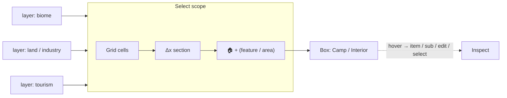
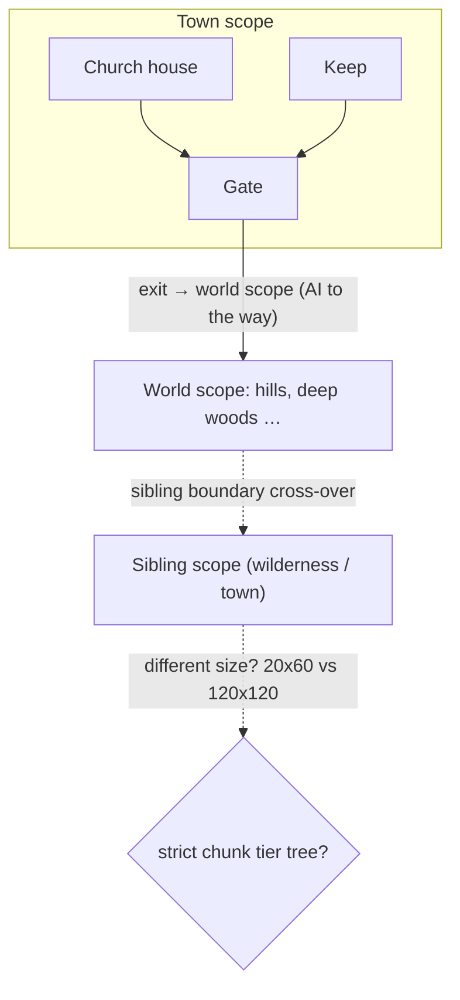
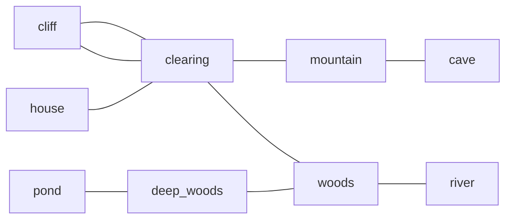
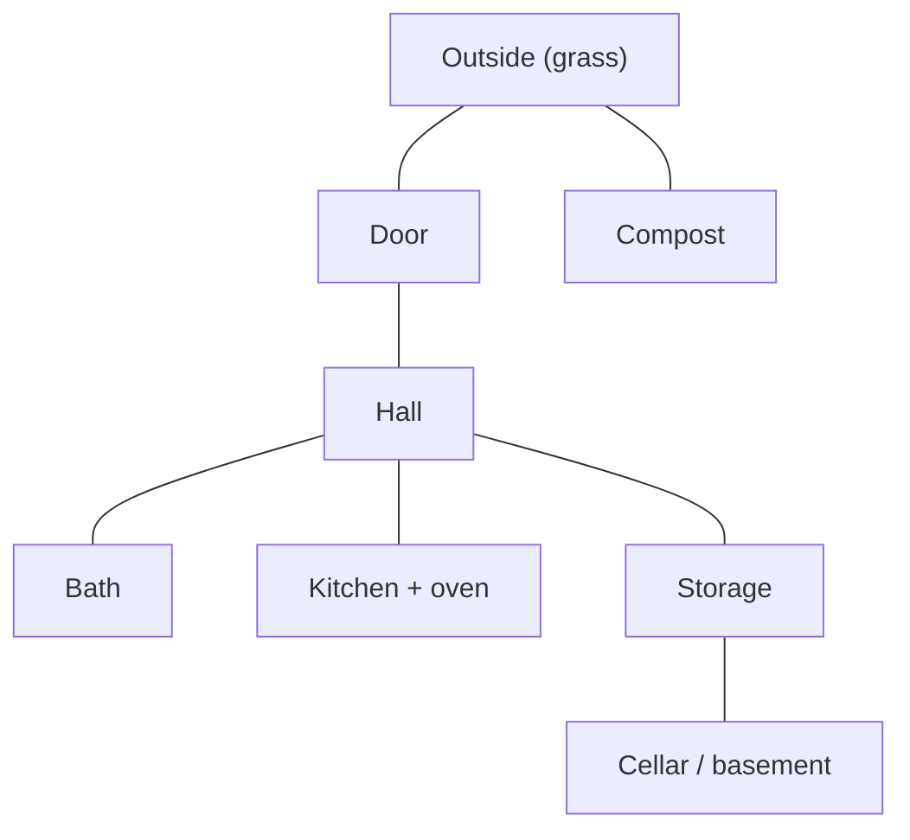
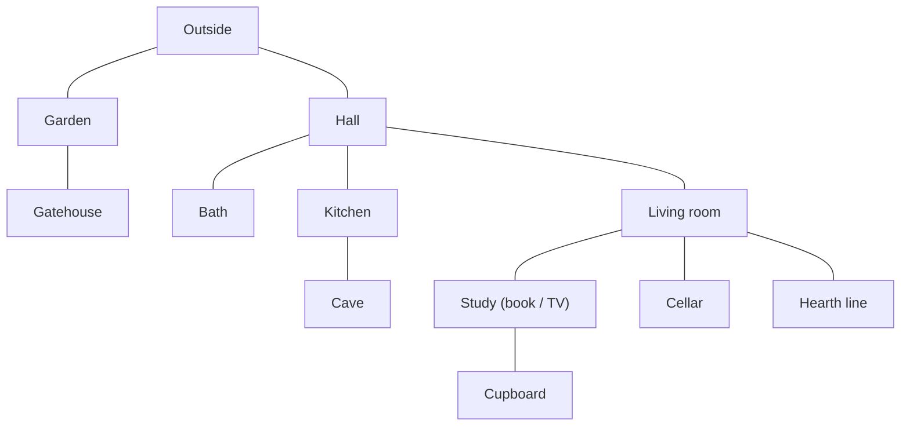
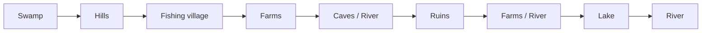
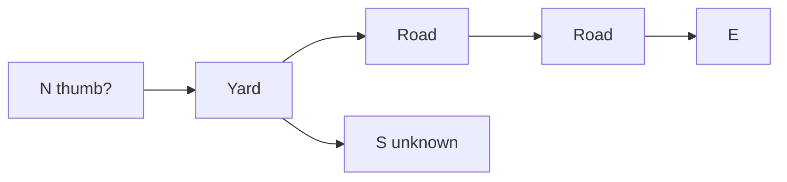

# World Notebook — handwritten notes (transcribed)

Transcribed from `virtualworld_notebook_notes.pdf` (28 pages, ~70 MB, modified
2026-10-09). This is a faithful best-effort transcription of handwritten notes,
not a specification. Handwriting is often ambiguous and some passages are
partly illegible.

Conventions:

- Wording is preserved as written where it is legible. Obvious spelling is left
  as-is rather than corrected, so the intent stays visible.
- `[?]` marks a word read with low confidence.
- `(illegible)` marks a passage that could not be read.
- Mermaid blocks are **interpretive reconstructions** of the hand-drawn
  diagrams, not tracings. They are marked with a caption saying so. Do not treat
  a node or edge as authoritative until the drawing is re-checked.
- Checklists keep their original marks: `[x]` ticked, `[ ]` unticked.
- Page numbers are the PDF page numbers.

This file lives outside `docs/virtualWorld/` on purpose: it is a source
transcript, not a curated vault note, so it is not subject to the vault guards
(`doc_tags`, `doc_connected`, `doc_pages`, `doc_links`).

---

## Page 1 — World generation and the painter checklist

> Paradise world-gen. 5th[?].
>
> How do you generate an island for a shiptile? Or a house. The island. Say a
> cave and a grazing. We can say a path / wind[?] [that divides?] for land /
> plane, tunnel. Street. Features. Generation needs several types. From A to B,
> expand option.
>
> **WorldPainter: World / Town / Interior modes.**
> In world paint biomes; adjacent square inverse[?] description.

Checklist:

- [x] Select world scale in terms[?] to traverse like [the] map → 10x10x10[?]
- [x] View biomes, place features (cities, key areas, resource, etc.)
- [ ] Layers of sight[?] via ways and amortisation[?]
- [ ] Overlays for resource-dist / hostile-dist / weather / temp[?] / climate, temp
- [ ] Heightmap / topography, a CSV or JSON, a colour key to features/biomes
- [ ] The map tool used to be [that the?] [e?][xplorers?] (illegible)
- [x] 8-way is [b/ng?] / tiers / descriptions (elevation, etc.)
- [x] Town: place features of towns — shops, buildings, cities, houses, lakes
- [ ] Interior: hallways, rooms, [tiles?], windows, fires, [illegible]
- [ ] Vehicle: a drivable item
- [ ] Template [trans?] for plants and resources (climbing bush, apple tree, fern, etc.)
- [x] Biomes: beach, cliff, forest, road, mountain, hills, [lake?], swamp, hills, etc.
- [ ] Energy conservation on u[phill]/downhill
- [ ] Scaling?

> Those waters has a low — deep woods → slope → towns → [field?] → land ...
> dense woods | randomising the terrains ... glacial in and others... [most
> lost?/sparse?] woods.

---

## Page 2 — Configuration needed

Checklist:

- [ ] Ability descriptions in prompt
- [ ] Backlinks / items with [count?] to say number of consumable items
- [ ] Item size, char size, way size
- [ ] Consider using graph edit (map) water level
- [ ] Send character portraits to own players
- [ ] Use [day?]/months /4/2/3 + elevation + portrait for [res?]
- [x] Water: swim, in/out, [barrier?], water-brush
- [x] WorldPainter tools: sewers, move, inspect, [flood?]
- [x] Bug: "move PG" in WorldPainter unreliable
- [ ] Character age
- [x] Fear affects [traversal?] checks
- [ ] Scale / back-sim (consider abilities and movement capabilities)
- beach — shrine — lake … bottom — underwater ↓ bottom
- [ ] How to handle prices, ledger, shops
- [ ] Quests, missions, jobs — how do we handle generated requests for others to complete?
- [ ] Fallout to biomes (dead forest, [tundra?], frozen, burned, [stare?]), frozen cliff, snow cliff
- [ ] Make characters not demand to stay in certain areas, like track/gather
- [ ] UI designer bot?

---

## Page 3 — Demons and their kinds (lore)

> Demons and devils, forests, hordes and abominations. A vast collection of
> creatures and spirits born by fear, manipulation, sin, disasters, offspring,
> and immense games[?]. In various forms and from a variety of sources, be their
> birth, transformation, intent, slavery or otherwise.
>
> Devils are more like [humans?], cunning, calculated, rising [through?] and
> suited to hierarchies; each devil is tied to an aspect of sin.
>
> Demons are more monstrous, unpredictable, wilder, or malformed. They're
> summoned as spirits/beasts. Demons kill easily, [feed?] on kills/soul
> consumption with more powerful souls worth more. Practically immortal, hard to
> kill, heal quick, eat for the joy of it, very slow metabolism, high stamina and
> magical aptitude. A demon lord usually comes from an incredibly powerful
> individual or their offspring. [Illegible] perils, good, strong, intelligent
> and easily affected. Impressed by fear, skill or achievements, curiosities of
> [rays?], souls, animus, pleasures or curiosities.

---

## Page 4 — Scope layers, walls, survival needs

> Select scope, add layer (biome, land/industry, tourism). Navigate, move cells.
> Fallout of [builds?], basin, hilly other, multi-clim[ate] features (hazards?).

Hand-drawn fragment: a grid with a "Δx section" label, a `🏠+` marker, and a box
labelled "Camp/[Foot?] Raft? Interior", with a note "hover to see item/sub/edit…
or select".

Checklist:

- [ ] Walls: why? It's not a [bare?] or it feels [description for all?] or areas. True?
- [ ] Checklist of survival needs: water sources / food sources / bathrooms / washrooms / public baths, river/[colony?] (water because cold) / houses / beds for person / entertainment / social / sanity.
- [ ] House water (interiors) — assume is a source of heat, kettle and water.
- [ ] Allow features and manual areas to occupy multiple cells like biomes.
- [ ] Dresser / checklist: (locks, glow, …)
- [ ] Pregnancy
- [ ] Schedule creator
- [ ] A toggling helper to see what might spawn

---

## Page 5 — Mini-games and tasks

> Mini games. Backgammon "[butter ship?]".
>
> Real tasks: make task cards for things I want to do that [I] can use to
> describe things I can do. Routines | habits | like to do | as to tasks with
> options what I can do. Name: what or who; description: what I see from a
> distance; example.

---

## Page 6 — Painter problems and the sibling-scope question

> Painters: scaling issues everywhere. Map/images and positions rotate to
> centre. Multiplayer from lobby. Documentation inconsistencies. No hard terms
> in library. Tag validation on thousands of items.
>
> Worlds or stories? The tools created should allow for a variety of stories in
> any setting or world. Let's generate a setting — can I work in my load game?
> Make hubs, features, scopes. Populate with biomes, lands, make characters …
> randomly generated NPCs, that's the big one … [illegible] … and run them.
>
> Biggest question: is it fun to play?
>
> **Sibling scopes, non-variant boundaries** — but I can see exit: can I travel
> across scope↔scope by enter? Hidden entrance, wilderness.

---

## Page 7 — Town to wilderness, travel cost

> WorldPainter: town map/description … you can walk from town to wilderness.
> 3 steps unless the centre[?] a world scope with exactly 2[?] similar …
> wilderness between, on a treasure, in a random town … you can also pass a
> forest in the wilderness. Slipping into these towns and the true scale of
> [the] towns — the size! In a wilderness …
>
> 2) How to build these … that the issue is 1) How to build these between 3x, 5x
> to ensure less … than the same town? Sibling town? Half a day's travel between
> … So instead of deciding [on] the scope to the world scope …
>
> Gate | Time cost | (change hops) Grass — forest wilderness, scope … town/scope,
> gate/scope …

---

## Page 8 — Current model and the chunk-tier question

> Current model: town / church house / keep / gate →; world: hills, deep woods …
> (in town there are …) you can [exit] gate → world scope towards wilds with AI
> to the way. But does [this] solve entity … if we do a [for each] town and lose
> an area … but does [it] solve the scaling issue … we do build cell features,
> unless we make the feature in world scale as big as its own scope,
> determining the … .
>
> **Sibling traversal solves it:** world scale only handles world chunks, then
> at boundaries we cross over to the sibling scope. But what if siblings have
> different sizes? Town being 120x120 aka 2H to [cross]? But wilderness is only
> 20x60? Is there a strict chunk tier tree? What if one sibling is much wider
> but all surrounding chunks are "tall"? Do we accept that? Well, if we were
> truly traversing a world, maybe not an issue.

Open question raised here: are sibling scopes equal-tiers, or can a town and a
wilderness differ in size? The page proposes the mechanism (world handles world
chunks; cross to the sibling at the boundary) but leaves the tier question open.

---

## Page 9 — Memory / Plans / Schedules UI

Memory / Plans / Schedules — click on memory to open `[edit] [delete]` icons.

Memories (examples written on the page): "Joked [Eyea?] to a spooky house", "I've
got a bad feeling this [has] …", "I hear something", "I [should] be home …",
"Saw cat". Fields: When: `01.02.2026`; Where: foyer; Who: "I heard something";
Type: personal / work / part of something; embedded. Actions: edit / delete /
save.

Plans: Task 1 / Task 2 / Task 3 — click to open details. Fields: What: find a
key?; How: look through the house; Prio: high; Why: [wander?] in the home;
Status: [doing].

Relations: `[name]` relation: friend, love, affection — colour bar: enemy,
neutral, like, family, friend, love, dislike; memories about…

---

## Page 10 — Biome adjacency graph and a cabin interior

Hand-drawn biome graph and a small building layout.

Hand-drawn cabin interior: bath, kitchen, oven, storage, door, cellar/basement,
beside "compost" / "outside grass" / "cabin".

---

## Page 11 — Actions, items, item types

Actions:

- Movement: go, walk, run, fly, climb, crawl, swim, jump.
- Items: use, combine, break, eat, drink, read, write, place, take.
- Communication: talk, whisper, shout, scream, yell, text, [slip?].
- Combat: attack, [stab?], grab, push.
- Interaction: examine, inspect, handle.
- Weapon: pickup, use, attack, stow, drop, repair, break, examine.

Item types: keys, tools, crates, food, weapons, containers, materials.

Trailing note: "[illegible] modes: [mutton?] worn on in drawer session."

---

## Page 12 — Template world changes (content wishlist)

> Template world changes

Checklist of authored-content wishes:

- [ ] Add NPC rats running, searching for food
- [ ] Livestream book stacks > books
- [ ] Leather chair in library / dining room
- [ ] A place to [sleep / rest?]
- [ ] [Slate?] units > off
- [ ] Cloth for ticking, old and dirty
- [ ] Apple on [log?] instead of on tree
- [ ] Apple halts his hunger
- [ ] Water pitcher full of fresh[?] fish
- [ ] Item requires menus for [user] handling on the place
- [ ] Bread is warm, why
- [ ] Medical cabinet to contain [provisions?] instead of spawn
- [ ] [Special?] relationships to [render?] descriptions
- [ ] Locked desk, new key, secured box
- [ ] Spell book spawns a spell in inventory
- [ ] [Firepit?] is hot and dry
- [ ] "OUT" [look?] know the [birthday/pain?]; it's impossible to [manipulate?]
- [ ] Bedrooms, 3 beds in the [town], personal [affects?]
- [ ] [Cellar]: wine/[tack?] supplies/fresh

Narrative paragraph on the page:

> While there are no signs of a struggle, there are signs of people suddenly
> gone. The [candle?] is that of a traveller braving the winter wilds. [He was?]
> [in?] reprieve; to escape the biting cold he is lucky enough to [gain?] a small
> farm house, lucky he [came]… The door was unlocked, inside was cold, but
> [un?]abandoned… [blankets?]. The kitchen [against?] from the [spool?] of
> [logs] and… bread? The [back?] kitchen door locked. Who [built] this kitchen.

---

## Page 13 — House walk-through: item affordances

> Living room > chair implies energy ✔; > fishing and > social/entertainment ✔;
> > books to entertainment ✔; > fireplace to temperature ✔; > key to box ☐;
> > poker is potential weapon ✔. Orange door > study > bedroom > spellbook >
> teleport to deeper town-end. Purple: shiny desk > kitchen > knives, apple,
> kindling; kitchen > trapdoor > (behind?) [dark] lots of food and drink. Stairs:
> hallway > 2 bedrooms; left door > main > letters to [lady] lord of the [g]old;
> hidden door > kids' room magical light > stairs. Door (end) > outside ⇐ START
> here.
>
> Travel equipment: torch, sword, bow, [lantern?], ration, cloak, map, empty
> waterskin, coat (increase energy cost to [warm] and reduce cold).

The pattern here: each item in a room names an affordance (chair → energy,
fireplace → temperature, books → entertainment, key → box, poker → potential
weapon).

---

## Page 14 — Room description as a collection of items

> Recording my [special?] relationships. Living room has a clock in the wall
> towards the kitchen door, a clock by the study door … and by the stairs the
> fireglow. In the fireplace is a [poker?]. The chair is in front of the
> fireplace. The wall next to the study door has bookshelves. One book is
> catching your eye.
>
> **Room description is a collection of items' passive descriptions.**

---

## Page 15 — Item and behaviour checklist

- [ ] Items by type
- [ ] Crafting by types: kindling, paper, oil
- [ ] [Reuse?] item action [on the?]
- [ ] Still [save?] still working / can see all stats on char
- [ ] [Some] in hand [slide?]
- [ ] Behaviour editor
- [ ] Trigger changed home on item
- [ ] Match on name
- [ ] Use "[name/run?] 2" on items and chests acts [rather?] with [spices?]
- [ ] When trying to use an item that only exists in descriptions, don't do "You
      see the iron X" but "[it does not?] [reveal/contain?]…" — [useful?] or not
- [ ] Only allow one equipped weapon / match on description
- [ ] Inventory limits on weight and volume / [parametrise?] (see configs)
- [ ] Item uses [affecting] weight / weight affects energy decay
- [ ] Place item in container / steal / take item
- [ ] Narrative actions to others / [print?] remember traumas, action/target/effects
- [x] Spells/abilities — arrow reduces uses per hit
- [ ] Item states / dash, run from danger into a [room] and [guide] to go again this [window/turn]
- [ ] Wind to affect temp
- [ ] Custom scenarios to test mechanics/features ~ [LABAS?]
- [x] Way size limit / claim increases the [size]
- [ ] Saves and [recipes] to trigger [Airin?]
- [ ] Choice to [stun] on attack/hit
- [ ] [Entering] actions / ticks/behaviours like buff, [coash?], stumble, [self?]
- (reversed/rotated text on the page: "Big — stop counter, [kaybese?] step for
  [size]"; "add to [2/6] and [the]"; "way to add [fire] [names]"; "go [up/down]
  [remain] [deps] [downward] when [downward]" — readings uncertain.)

---

## Page 16 — Schedules: the receptors of life, pursuits

> **Schedules: the receptors of life, pursuits.** Schedules are the building
> block of what tells someone what they have to do, but on a higher level than
> their needs. Where a need says: "I need to take care of this [bodily] need", a
> schedule says "to achieve my goal of X, I need to go here, do these actions
> between start and stop." The idea is much the same as the early implementation
> of plans. The [model] I have is that schedules are made by authors, missions,
> jobs, and agents themselves.
>
> Let's say Frank — he is now a merchant in Eldenford, specialising in gemstones,
> tending the northern hills. Travel there takes about 4 hours. To stay there for
> the days and to forage … and to [need?] a [pickle?]… as such the schedule is
> formed as (**where, how far, doing what, how long, requirements**).
>
> Now the second part would be decision. Unlike the [fisherman simplex?], Frank
> should be able to reason about which schedule tile to use — maybe he had
> [monsters] there [lately], and wants [protection?]; maybe he gets goblins on
> the way, or abandons; maybe he realises the goblins [are stationed] and he can
> stay extra long.
>
> **GOSP: goal-oriented schedule planning?** Should build on memory, needs,
> wants, [subconscious?] [accents?] and relationships. [Bottom:] orientation
> schedule planning for goal completion.

---

## Page 17 — Only relevant schedules

> We don't want to list all schedules for an agent, only the relevant ones. So
> the top ones are the important [ones].

---

## Page 18 — "Vanishing in the cold" (scenario draft)

> Who are they? Why is a [sailor/wanderer] [so] looking for … Why does he have a
> handwritten spellbook.
>
> Mission note: the king has [personally] requested a [well?] … of an old friend;
> [workshop] of a [wizard] for the kingdom's safety. A week's worth of travel …
> cold … [the guy?] got into a fight with a wolf. Man, wife, son; human, elf,
> half-elf; [shadows], [hearth] …

Hand-drawn house map (labels read from the page): bath — hallway — kitchen;
[cellar] / [living]; [gatehouse] / garden; living-room — study — book/TV;
cupboard; outside; [line of hearth] / cave.

---

## Page 19 — Items of "The Vanishing"; change flame / create light

Items by room (as written):

- Wardrobe: 3 boots, letters, map, sword, [shadow] coat.
- Kitchen: soup gone cold, pantry, bowls, [clothes?].
- Bath: soaps, [kettles], towels, wooden [bath].
- Cellar: water casks, [empty/ropy] barrels, cheese, big [tin].
- Kids' bedroom: toys, books, trinkets, bag, open window, light source.
- Master bedroom: lanterns, letters, candle, clothes, book + desk.
- Living room: statue, paintings.
- Servants' room: bed, clothes, letter to sister.
- [Tavic] room: [cleaning], candles, [fishing] wood skin.
- Outside: [light]stone, [hearth line], toilet, washbasin.
- Study: [letter], [ink], [toking], skull item, [handsome] book + TV.

Mechanics noted:

- **Change flame:** spawn item time; add heat + light; time limit; consume energy `1c`.
- **Create light:** spawn item [lint], add light [loom?], consume 5 energy.

(Dinner table listed among items.)

---

## Page 20 — Personal journal entry (not design)

This page is a personal journal entry dated *19.07.2026* ("New book, same shit"),
about a domestic situation. It is **not** design content and is deliberately
**not transcribed here**. Say the word if you want it included; otherwise it
stays out of this document.

---

## Page 21 — Triggers: what and to whom

- [ ] [Linking?] way target / source + direction name
- [ ] Change view: "the X"
- [x] Chemistry items/triggers should show me *what* and *what to whom*; e.g.
      "Jolip ate an apple, hunger decreased by 5"
- [ ] Aliases — personal aliases? Agents calling themselves, and add it as a
      hidden alias?
- [x] Use X item on target: "use 2 eggs on pan"
- [x] [Thickness] of consumables / [ ] states: raw / cooked / spilled
- [ ] Wind and water detection on insulation
- [ ] Use item returns it to where it was, had equip?
- [x] Take equips item to hand/hands
- [x] Can see into area to see char, item, items, ways
- [x] [Multiplexed] on who can be seen?
- [x] Trigger validation (checking for invalid ids, etc.) shows up as warnings
      on left panel
- [ ] New action: teach recipe/skill
- [ ] Effect and condition graphs: general, ways, trap/chm/areas
- [x] Add or remove memories on char
- [ ] Trigger to change character personality and description
- [ ] **True conditional triggers:**
  - if condition1 true then effect 1+2…
  - else if condition2 then effect 3
  - else fail message + effect 4
- [x] If item has trigger for an action, enable the action or warn user

The header also lists trigger subjects (world, ways, agents, examinations,
items, …) — the list is partly illegible.

---

## Page 22 — "Task 14: Eat and drink"

> Crafting? A small farm with an oven for eggs, milk, water, oven, knife,
> [strain?], [flashcards?], pan.

Worked steps:

- Should [have] than [stor?]
- Use eggs on pan > pan [has] egg
- [Slip?] eggs [7?]
- Use milk on pan > pan [has] milk
- Use knife on onion > onion slices; [cut] onion
- Use onion on pan > pan with egg/milk/onions
- [Place milk] [to] pan
- Place [o] oven
- Use pan on oven > pan on oven
- [Take knife / egg?]
- Use [strain?] on pan > [add] [mixture]
- Place egg [shell] in trashbag
- Examine pan > how long till done
- Place [omelette] on plate
- [Eat] omelette

Questions written after:

> How can skill play in? How to generalise? Recipes — learning: all require needs
> and steps [into] a stateful action [that] is [??] — and less chance of failure.
> Recipes used as "make [omelette]", [hoards] progress, [fireman?]. Missing
> requirements are [have/leave]… skill requirement and experience?

---

## Page 23 — Recipe schema and a worked example

> Recipes: **Name, Type, Required Items, Required Tools, Time, Result/Outcome,
> Skill.**

Worked example:

> **Nails.** hardware. Anvil, metal, [furnace], hammer. Optional: [pliers],
> gloves, [buckle/clasp]. [Source?] tools, metal, [heads]. Time: 5 turns.
> Outcome: 10 nails per unit of metal. Skill: blacksmith.

---

## Page 24 — "Task 19: NPC" reaction lines and skills

NPC story lines, per area:

- on encounter: "Why are you asking me / [like] that?"
- on enter: "[Open hallo?]"
- on enter: "I am …"
- on [grab]: "Hey, [is] your [head?]"
- on [stolen]: "Oh [ick], thank you"
- on [poke]: "Stop it, that's rude!"
- on [stretch]: "I am …"
- with [5] feelings: "Have you seen…? What is this place and …"
- on [attack]: "Run away"
- on [attack2]: "Give a [battle] [threat] / [challenge] in track"

NPC skills: wander, [poster?], follow, flee, social, travel, steal, [hurt?],
repair, track, talk, [eat].

---

## Page 25 — "Task 16: Triggers" — event types to test

> Goal: test and confirm every type of trigger, condition and effect.

- on use
- on use-on[?]
- on examine
- on take
- on drop
- on enter
- on exit
- on eat
- on drink
- on equip
- on unequip
- on fall
- on speech
- on tick
- on turn

---

## Page 26 — Broad checklist

- [ ] Clear each clue how items and triggers
- [ ] [Sharp cuts] with realism, beliefs and…
- [ ] Improved human players' intent with/talk terms, info
- [ ] Multiplayer (human) p0/ps?
- [ ] Graph: hide item triggers/graph unless clicking on region M
- [ ] Level/skill way: show only [hides?] others between tiers
- [x] Group areas and ways into collections for higher-level views
- [x] Grid mode/coordinates vs physics
- [ ] Click to split an area, from ways; create [child?]
- [x] Improve use of templates then [library]
- [x] Singing and whisper to target
- [x] Shopkeeper's terms show initiative list, trigger all of the [seen] … in talks, [access] terms
- [x] Images on items, [silhouette] for areas
- [ ] Bark logic for creatures, show name of animals? description
- [x] Select template to sync from
- [x] Save to template
- [x] Warn on template mismatch
- [ ] Read vital as condition and effect
- [ ] Refer on use: create new item/inside for camera, voice recorder, etc.
- [ ] Long-distance communication: phones, walkie-talkie, radio
- [x] Change clock

---

## Page 27 — Simulation, AI direction, timeskips

- [x] Simulate select/script characters
- [x] Only simulate in select/local area
- [x] Map to area hierarchy
- [ ] The random internally order[?]
- [ ] Director AI that uses lore and speaks as [GM], and tools to direct the story
- [ ] Events randomly [fire] to delay said memories and director
- [ ] Player wait, pastime, explore, search, "rest/ritual/talk"
- [x] Add injuries per zone
- [x] Generate areas between areas ([~300?] load + biome)
- [ ] Grab and [have?]
- [ ] Talk to (confirms)
- [ ] On player wait/list action, [fire] all agents [into a search?]… include into a text state to solve their [tasks], survive, use items logically
- [ ] Simpler NPC to use search logic unless behaviour overrides
- [ ] Character on character (householder/farm)
- [ ] Add tag/interest/year as [management]
- [ ] [Area on map] enter: [make an area that has wild generated]
- [ ] Gain map knowledge to traverse; different from someone [simpler] to go west for an hour vs known route; map from [holes] on a player map?
- [ ] Sights to show ways that can be tempered with
- [ ] Skill check to find direction to [solve/use] target
- [x] Grid to map, made for [riding]
- [ ] Random events during timeskips

---

## Page 28 — World layout and "preceding area" idea

Hand-drawn world layout:

Also written on the page:

> Village / manor / [church houses] / tavern [barkeeps]
>
> **Grid biome painter!**
>
> Preceding-area idea: N[?] — yard — road — road — E | S | Unknown

---

## Loose themes across the whole notebook

These recur and are worth pulling out of the per-page detail:

- **"Is it fun to play?"** (p6) and **"Worlds or stories?"** (p6) — the framing
  question behind the tooling. The tools should let any setting/world tell a
  variety of stories; random-generated NPCs are called "the big one".
- **Scale / traversal** (pp. 1, 6, 7, 8, 27, 28): grids, chunks, gates, travel
  time, map knowledge. The chunk-tier question on p8 is the open one.
- **Composition over authoring**: rooms described by their items (p14), items
  naming affordances (p13), templates (pp. 1, 12, 26).
- **Crafting + skill** (pp. 22, 23) and **recipes as data**.
- **Triggers** with a fixed event vocabulary and conditional effects (pp. 21, 25).
- **Schedules / pursuits / GOSP** (pp. 16, 17) — already codified elsewhere in
  the repo (`Character Pursuits.md`, task-699 and related), so listed here for
  completeness, not as new work.
- **Biome fallout/states** (p2) and **layers beyond the current four** (p4).
- **Survival needs including social/sanity** (p4).
