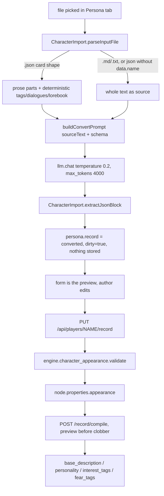

# Persona import, LLM fill, and character round-trip

Design note. Written 2026-10-18 from a live audit of the import flow plus the
save/load paths it feeds. It records what exists today, what the author asked
for, and the decisions that have to be made before any task is filed. It changes
no code.

Em-dash is banned in this repo; none appear here.

---

## 1. Scope

The feature under review is **import a character file into the Persona sheet**:
pick a file in the Mind to Persona tab, an LLM converts it to the structured
block, you review it in the form, then save.

The audit is broader than the import call, because the same sheet feeds two
persistence paths (scenario save/load, character library save/import) and the
questions the author raised sit on all three: the prompt, the sheet, and what
survives a round trip.

Sections 2 to 4 are the measurement. Sections 5 and 6 are the asks and the open
decisions. Nothing here is a task yet.

---

## 2. The path as it exists today



Where each step lives:

| Step | File |
|---|---|
| parse, prompt, extract | `static/js/character-import.ts` |
| the tab, the import handler, the form | `static/js/inspector/mind-view.ts` (`_importPersonaFile` ~1880) |
| schema, validate, compile | `engine/character_appearance.py` |
| GET/PUT `/record`, `POST /record/compile` | `routes/player_ops.py` (~849-1188) |
| scenario save/load | `engine/serialization.py` |
| character library save/import | `static/js/inspector/agent-view.ts` (~2178), `routes/library_ops.py` (~879) |
| size dropdown (not the persona tab) | `static/js/inspector/agent-view.ts` (~439) |

### 2.1 The prompt, quoted

`character-import.ts:124-144`:

```
system: Convert the character material below into ONE JSON object matching the schema.
Rules, no exceptions:
- output ONLY the JSON object, no prose around it;
- fill only what the material states; leave everything else out (absent, not null);
- id-list fields (likes, fears, kinks, interests, ...) hold slugs: lowercase, digits, _ or -;
- prose-list fields (traits, quirks, ...) hold free text;
- never invent names, ids, memories, or backstory;
- biography/secrets stay brief; secrets are never expanded beyond what is stated.

user: SCHEMA:
<JSON.stringify(schema)>

MATERIAL:
<sourceText, capped 24000 chars>
```

### 2.2 The schema, quoted in shape

`schema_for_llm()` (`character_appearance.py:907-1006`) returns the four-section
object. What it puts in `description` is the whole problem:

- group subfields: `description: f"{field} {sub}"` (for example `"hair color"`).
- personality list fields: `description: f"ids of {mechanic}"`.
- everything else (identity, most of appearance, narrative): **no description at
  all**. `{"type": "string"}` and nothing more.

So `identity.sexuality` reaches the model as `{"type":"string"}`. `appearance.build`
reaches it as `{"type":"string"}`. The model is handed field names and no meaning.

---

## 3. Findings (each verified, evidence given)

**F1. The prompt is a bare schema.** The only per-field text the model gets is
the group-subfield name, and `"ids of <mechanic>"` on personality lists. Every
other field is a name and a JSON type. This is the author's "holy, it sucks".

**F2. The schema and the rules contradict each other on prose lists.**
`schema_for_llm:952` labels `traits`, `aspirations`, `quirks`, `habits` as
`"description": f"ids of {mechanic}"`, while `PROSE_LIST_FIELDS` (`:135`) and the
prompt rule say those hold free text. The model receives both statements.

**F3. The deterministic extractions are computed and then dropped.**
`_parseCard` builds `deterministic.tagCandidates`, `.dialogueCandidates` and
`.lorebook` (`character-import.ts:94-110`). `_importPersonaFile` only reads
`parsed.sourceText`, plus `parsed.deterministic.lorebook.length` for a note
(`mind-view.ts:1910`). `tagCandidates` and `dialogueCandidates` are read by
nothing. The module header says the deterministic layer "pulls what is certain
without a model"; it pulls, and nothing consumes it.

**F4. Empty fields are the design, not a failure of the model.** The rule
`fill only what the material states; leave everything else out` plus
`never invent ... backstory` means a thin material yields a thin sheet on
purpose. "Every field should get written to" is in direct tension with this
rule; it has to be a decision, not a bug fix.

**F5. A non-card JSON is stringified and truncated.** The sample file
`C:\Users\Tommy\Downloads\Person_Erin_Mae_Halloway_2026-10-18.json` is a
"worldgraph" profile: top-level `character.basic_info.name.full`, not the
SillyTavern/Chub `{data:{name,...}}` shape `_parseCard` looks for
(`character-import.ts:66-80`). With no `data.name`/`name`, it falls to the prose
branch: `JSON.stringify(raw).slice(0, 20000)`. The model therefore reads a
JSON blob (all keys and braces) rather than prose, and anything past 20 000
characters is silently cut.

**F6. The sexuality vocabulary exists, but not in the schema.**
`IDENTITY_SUGGESTIONS["sexuality"]` (`character_appearance.py:85`) lists
`straight, gay, lesbian, bisexual, pansexual, asexual, queer, demisexual`. It is
served to the tab as `suggestions` (`routes/player_ops.py:885`), never to the
model. The stored value is a free string (validation does not check it), so the
file's `"Bisexual"` is stored capitalised and untouched. The author's
"hetero, bi, asexual, etc." is the vocabulary that already exists in one place
and is absent from the place that needs it.

**F7. `build` is a bare string, spliced into prose verbatim.**
`appearance.build` is `("text", None)` (`:47`); `render_record_prose` appends
`str(looks["build"])` as a clause (`:654-655`). There is no guidance, and no
prose around it. A one-word answer stays one word.

**F8. Secrets are blurred by the editor, and the prompt keeps them terse.**
The tab renders `narrative.secrets` behind a click-to-reveal blur
(`mind-view.ts:1214`, `.pf-locked { filter: blur(4px) }` at `:1096`), and the
prompt says secrets "stay brief; never expanded beyond what is stated". The
author editing their own character does not want the blur; it belongs to a
reader who is not the author.

**F9. Size is not a Persona field.** It is a dropdown in the character
inspector header, next to the vitals (`agent-view.ts:439`), PUT as `{size}`.
The Persona tab never shows it. Two different surfaces own one character
property.

**F10. Size does not survive a scenario round trip.** `_serialize_player` writes
`"size"` into the players block (`serialization.py:154`, and `player.py:1365`
in the live payload), but `_deserialize_player` (`serialization.py:373-` ...)
never reads `pdata["size"]`. A save carries size; a load drops it, and the
character falls back to a `size_*` trait or `normal` (`engine/size.py:18`).

**Fixed 2026-10-18 (task-874).** `_deserialize_player` now reads `size`,
normalised to a tier or `None`; `None` stays `None` so the trait fallback holds.

**F11. Size does not survive a library round trip either.**
`_buildCharacterCard` (`agent-view.ts:2178-2242`) omits `size`, and
`handle_library_import_character` (`library_ops.py:879-997`) never sets
`player.size`. The dropdown writes the Player only.

**Fixed 2026-10-18 (task-874).** The card carries `size` and `species`; the
import sets both. The library characters already carried them (68 files have
`"size"`, 35 have `"species"`); only the reader was missing.

**F12. The Persona block is not in the character library card at all.**
`_buildCharacterCard` reads the character node for `image`, `profile_image` and
`expressions` only; it never includes `properties.appearance`. Library import
copies those three keys back and nothing else (`library_ops.py:952-960`). So
**Save to Library loses the whole Persona sheet.** A scenario save keeps it,
because the block lives on the node (`to_scenario_dict` serialises the graph).
This is the larger problem under F11, of which size is one field.

**Fixed 2026-10-18 (task-874).** The card carries `properties.appearance`, and
the import writes it back onto the character node next to the expression pack.

**F13. There is no per-character export.** The item library has its own
`_exportJSON` (`static/js/item-library.ts:445`). The Persona header offers
import, save, compile and nothing else (`mind-view.ts:1586-1589`). The only
export-shaped path is the scenario export (`POST /api/save-scenario`,
`routes/saveload.py:717-722`), which returns the whole world.

### 3.1 Two different things: the block and the description

Easy to conflate, and the data model keeps them apart:

- `properties["appearance"]` (`RECORD_KEY`, `character_appearance.py:38`) is the
  **structured block** - identity / appearance / personality / narrative. It is
  the sheet you edit in the Persona tab. `appearance` here is a key name, not the
  English word "appearance".
- `base_description` and `personality` are the **compiled prose**, written from
  the block by Compile (`_apply_compiled`, `routes/player_ops.py:998-1017`), onto
  both the node and the Player.

So "appearance is the description" is not true in the storage model: the
description is a *projection* of the block. It matters here because the library
card carries the projection and not the block (`_buildCharacterCard` reads
`player.base_description` / `player.description` / `player.personality`). A
library round trip therefore returns the paragraph and loses the fields that
produced it: the prose survives, the sheet does not. That is F12.

---

## 4. Round-trip matrix

Rows are what a character carries. Columns are the paths a character moves
through.

| Data | Scenario save/load | Library save/import | Persona tab |
|---|---|---|---|
| `properties.appearance` (the sheet) | kept (on the node) | kept (task-874) | the editor |
| `size` | kept (task-874) | kept (task-874) | not shown (F9) |
| `species` | kept | kept (task-874) | not shown |
| `personality` / `description` / `base_description` | kept (node) | kept (Player attr) | written by compile |
| `interest_tags` / `fear_tags` | derived on compile | `interest_tags` kept, `fear_tags` dropped | written by compile |
| `image` / `profile_image` / `expressions` | kept (node) | kept (node) | not shown |
| `stats` / `vitals` / `skills` / `traits` / `tags` | kept | kept | not shown (other tabs) |

The two "dropped" columns are the reason the author's "size does not save"
experience has three separate causes: one lost key on the scenario load
(F10), one missing key in the library card (F11), and the sheet itself missing
from the library card (F12).

---

## 5. The author's asks, mapped

| Ask | Today | Gap | Layer to fix |
|---|---|---|---|
| The prompt should explain each field, not just name it | bare schema (F1) | add per-field `description` and vocabulary | engine schema + prompt |
| `sexuality` should mean sexuality (hetero/bi/ace/...) | free string; vocab only in the tab (F6) | put `IDENTITY_SUGGESTIONS` into the schema | engine schema |
| `build` should be described, not one word | bare string, spliced verbatim (F7) | guidance in schema/prompt, prose render | schema + prompt |
| Every field should get filled | prompt forbids inference (F4) | decided: model infers and fills every field | prompt design (see 6) |
| The secret field should not be censored for the author | blurred + "keep brief" (F8) | remove the blur in the editor; relax the prompt | UI + prompt |
| Export a character | none (F13) | an export button + a download shape | UI + route |
| Size should be in the Persona tab | Advanced header only (F9) | move/repeat it; one owner | UI |
| Size should save | lost on load (F10); dropped in library (F11) | read `size` on load; add it to the card | engine + UI |

---

## 6. Decisions taken (2026-10-18)

These are settled. The tasks that follow implement them.

- **Fill policy: maximal, with inference.** The model should invent what fits the
  character and write every field it can, rather than leaving gaps. This
  reverses the current prompt rules (`fill only what the material states`,
  `never invent ... backstory`, F4).
- **Inferred values are marked.** A value the model invented, rather than read
  from the source, carries a visible marker in the form so the author can tell
  the two apart at a glance. The request was a sparkle (✨); whether the marker
  sits on the field or on the individual value is a UI decision for that task.
  The **prompt has to emit the provenance per field**, so this is the contract
  the prompt task builds to, not an afterthought.
- **Tags are wanted and must be usable.** The deterministic `tagCandidates` and
  the id-list fields should reach the sheet instead of being dropped (F3), so
  `fear_tags` / `interest_tags` and the other id lists do real work.
- **The character must persist its sheet.** `properties["appearance"]` and
  `size` must round-trip on the character, on both the library path and the
  scenario path (F10, F11, F12).

## 6.1 Open decisions (answer these before tasks)

1. **Prompt enrichment: how far?** The schema is the contract `PUT /record`
   validates against, so adding `description` and `enum`-like vocabulary to it
   is safe (validation ignores descriptions). Do we (a) enrich the schema
   descriptions only, (b) add a written field manual to the system prompt, or
   (c) both? (a) reuses `CONSUMER_HINTS` and `IDENTITY_SUGGESTIONS`; (b) lets us
   say *why* a field matters.

2. **The worldgraph JSON shape.** Do we teach `parseInputFile` the
   `character.basic_info.*` shape (F5), or add a generic "flatten any JSON to
   labelled prose before truncation" step? The sample file is a real format and
   will show up again.

3. **Secrets.** Unblur in the Persona editor (author context) and keep the blur
   only for a non-author reader, if one exists? And does the prompt rule relax,
   now that the fill policy is maximal?

4. **Size ownership.** Is size a Persona field (identity/appearance fold) or an
   inspector-header field that merely needs to round-trip? One owner, not two.

5. **Export shape.** One button in the Persona header that downloads the same
   JSON the library card uses, so export and save cannot drift? Or a distinct
   "full character" shape that also carries the sheet?

### 6.2 Adjacent findings to file separately

- **prose-list fields are labelled "ids of"** in `schema_for_llm:952` (F2). A
  one-line engine fix, but it is a schema bug, not part of the prompt rewrite.
- **`Player.personality` / `description` set by library import land on the
  Player, not the node** (`library_ops.py:903-905`), while the invariant says
  authored definition lives on the node. Worth checking against the
  serialization note at `serialization.py:120-128`.

---

## 7. The source schema (WorldGraph) against ours

The doc at `F:\AI\code\graph-editor\docs\character_person_fields.md` describes the
**WorldGraph** person node - the *source* format an import reads, not the ViWo
Persona. It is useful precisely because it is richer: it lists every field a
source file can carry, so we can see which ones ViWo has a home for and which it
does not.

The import has no mapping today. `buildConvertPrompt` hands the model the ViWo
schema and the raw source and asks it to fit one to the other (F1). A source
field with no ViWo counterpart is therefore either dropped or squatted into a
field that means something else: `residence` has nowhere to go, `orientation`
and `sexuality` both want `identity.sexuality`, and `media`/`mbti` have no home
by design.

### 7.1 Field by field: WorldGraph -> ViWo

| Source field | ViWo home | Verdict |
|---|---|---|
| `name.full/first/last/...`, `nicknames`, `aliases` | one name, plus `unknown_name` | **no home for parts, nicknames or aliases** |
| `age` | `identity.age` | keep |
| `birthdate` | `birth_tick` / lifecycle clock | **derive**, an in-world clock has no 1994 |
| `gender`, `pronouns`, `species` | `identity.*` | keep |
| `nationality`, `ethnicity` | none | **missing** |
| `occupation` | `identity.occupation` | keep |
| `residence.*` | none (see 7.2) | **world reference**, not a field |
| `marital_status`, `partner` | `player.relationships` (runtime) | **world reference**, not a field |
| `appearance.*` | `appearance.*` | mostly keep; no `body.chest.size` / `description` split |
| `genitalia.*` | none (`body.modifications`, `body_state` sensitivity) | **missing** (intimacy fields) |
| `style.*`, `scent`, `voice.*` | `appearance.style` / `.scent` / `.voice` | keep |
| `personality.traits/likes/dislikes/fears/aspirations/quirks/habits/speech_pattern` | `personality.*` | keep |
| `mbti`, `alignment` | deliberately absent (nothing reads them) | **unread fiction** |
| `biography.early_life` / `adulthood` (structured) | `narrative.biography.*` (strings) | keep, flattened |
| `current_situation` | `narrative.biography.current_situation` | keep |
| `relationships.{family,friends,enemies,...}` | none authored (runtime only) | **world reference**: links + memories |
| `secrets.*` | `narrative.secrets` | keep |
| `capabilities.skills` | `player.skills` is numeric | **missing** (free-text skills) |
| `languages`, `weaknesses` | none | **missing** |
| `kinks_and_sexuality.orientation` | `identity.sexuality` | keep (map the key) |
| `experience`, `turn_ons`, `turn_offs`, `boundaries` | `personality.*` | keep |
| `preferences`, `curiosities` | none | **missing** |
| `narrative.arc`, `role_in_town` | `narrative.*` | keep |
| `potential_storylines` | none | **unread fiction** |
| `example_dialogues` | `narrative.example_dialogues` | keep |
| `media.favorite_*` | deliberately absent | **unread fiction** |
| needs, memory, knowledge, mood, plan | not in the source at all | ViWo-only, runtime |

### 7.2 Residence, answered

A residence is not a property. As the author put it, nobody carries "my address"
as a field; they know where their bed is. ViWo already has three seams for that
fact, and none of them is the persona sheet:

1. **Behaviour**: `player.schedule`, a step `{start, activity: "sleep", area}`.
   This is "where I am at night", and `sleep` is a known activity
   (`engine/schedule.py:35`). A residence is a schedule step, authored or
   inferred.
2. **Standing**: `engine/ownership.py` - a character carries `faction:<name>`
   and an area carries `held_by:<name>`. It is faction-level today, so a
   household is expressible (`faction:halloway` holding `held_by:halloway`), but
   a *personal* "this is my room" is not. That is the gap to name if residence
   needs to be an ownership claim.
3. **Knowledge**: `player.known` plus a memory record ("I live at The Pines
   2D"). This is the one the author is pointing at, and it is the right default:
   the LLM agent asks its own memory where its home is, exactly as a person does.

So the import should **resolve** a source residence: if the area exists in the
graph, wire knowledge and/or a schedule step; if it does not (the common case for
a foreign file), keep it as a memory, never as a persona field. A `residence`
field on the sheet would be a fourth, unread source of truth for "where does this
character live", and the schedule, ownership and memory systems would go on not
reading it.

### 7.3 The general rule this exposes

Every imported field falls into exactly one of four buckets, and only the first
is a persona field:

| Bucket | Examples | Handling |
|---|---|---|
| **A. Intrinsic** | age, gender, appearance, personality, secrets, arc | persona field. Fill, enrich, mark inferred. |
| **B. World reference** | residence, partner, family, friends, workplace, birth place | resolve the name to a node id, then a knowledge/memory (and schedule/ownership where it fits). Never a free string on the sheet. |
| **C. Derived / runtime** | current area, mood, inventory, needs, health | computed. Never imported as authored data. |
| **D. Unread fiction** | mbti, alignment, media, potential_storylines | give it a reader, or keep it out of the sheet (a notes/prose field at most). The Persona page's own rule: a field nobody reads rots. |

The machinery we are missing is a **mapping plus resolution step** between the
source schema and the sheet. That is what tells an import that `residence` is a
bucket-B reference and `mbti` is bucket D, instead of hoping the model guesses
per file.

### 7.4 What is wrong in the source doc itself

- **Two live keys for one concept.** `basic_info.sexuality` appears in the
  dropdown table (`FIELD_OPTIONS`) while section 2 has no such field and the note
  at line 233 says sexuality moved to `kinks_and_sexuality.orientation`. The
  import must accept both spellings for `identity.sexuality`; a doc that keeps
  the stale one is a trap for the mapping.
- **`partner` is documented as "id or name"** (line 62), which admits the source
  already treats a partner as a reference, not a string. Residence is the same
  once it names a real place.
- **Two export shapes, neither a card.** The JSON person node, and the markdown
  profile dump (`exportMarkdown`, section 6 of that doc). Our `parseInputFile`
  understands only the SillyTavern `{data:{name}}` card or free prose, so both
  WorldGraph shapes land in the truncated-stringify branch (F5).

---

## 8. Suggested test plan (for when tasks are cut)

- **Unit, schema:** every field in `APPEARANCE_FIELDS` / `IDENTITY_FIELDS` /
  `PERSONALITY_FIELDS` / `NARRATIVE_FIELDS` has a non-empty `description` in
  `schema_for_llm()` output, and every prose-list field's description does not
  say "ids of" (closes F1, F2).
- **Unit, import parse:** a worldgraph-shaped JSON yields prose, not a stringified
  blob, and does not silently truncate at 20 000 (F5).
- **Unit, deterministic:** `tagCandidates` and `dialogueCandidates` either reach
  the record or do not exist (F3).
- **Round-trip, engine:** a Player with `size = "giant"` survives
  `to_scenario_dict` -> `load_from_dict` (F10).
- **Round-trip, library:** a character with an `appearance` block survives
  Save to Library -> import (F12).
- **Live:** import the sample file in the Persona tab and read how many fields
  the model filled, with the enriched prompt vs the current one.

---

## 9. Files touched by any fix

- `engine/character_appearance.py` - schema descriptions, vocabularies, prose
  render for `build`.
- `static/js/character-import.ts` - prompt, non-card JSON handling, deterministic
  wiring.
- `static/js/inspector/mind-view.ts` - import handler, secrets blur, export
  button, possibly a size field.
- `static/js/inspector/agent-view.ts` - `_buildCharacterCard`, size dropdown.
- `engine/serialization.py` - read `size` in `_deserialize_player`.
- `routes/library_ops.py` - restore `appearance`/`size` on import.
- `routes/player_ops.py` - only if a new export route is added.
- Docs: `docs/virtualWorld/Characters/Persona.md`, and this note.

---

## 10. See also

- [[Persona]] - the feature page this audit is against.
- `docs/design/person-data-model.md` - what a person's data is in ViWo, and
  where each imported field belongs.
- `docs/design/sibling-scope-traversal.md` - the same style, a different
  investigation.
