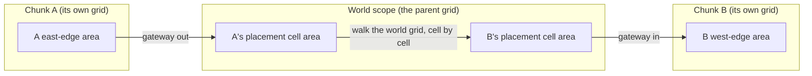
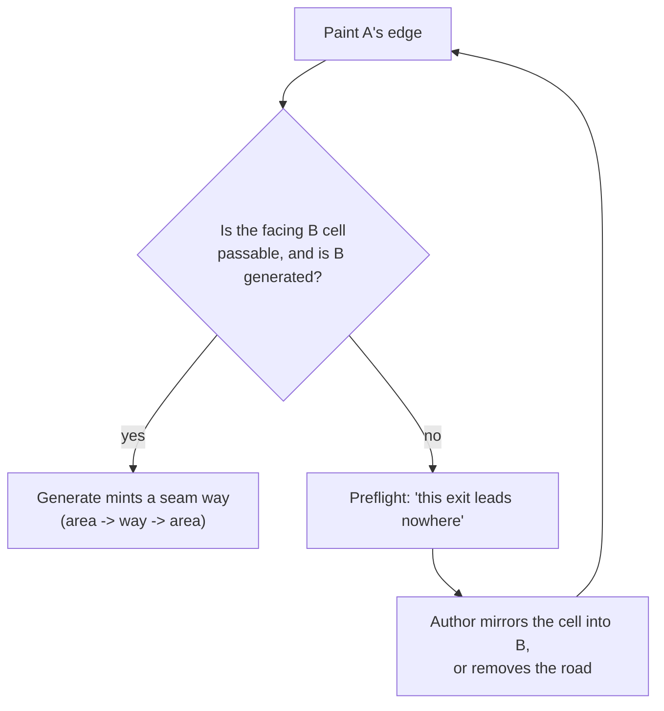
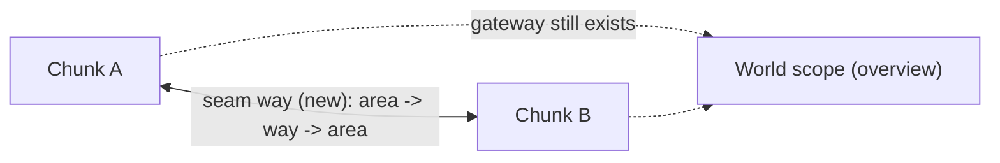

# Sibling-scope traversal: current state, target state, and what task-775 asks for

**Written:** 2026-10-18
**Scope:** `task-775` (sibling-scope traversal: border seam remap and footprint placement).
**Status of this document:** a comparison, not a decision. Every code claim here was
read on 2026-10-18; the open decisions at the end are proposals, not ratified
choices.

This page exists because the task card was filed from a notebook sketch, and the
sketch assumes a seam has to be built. Most of it already exists, inside one
scope. The gap between "what is there" and "what the card asks for" is much
smaller than the card reads, and two of the card's rules contradict the
machinery they say to reuse. This document lays that out in three columns:
what the task files assume, what the code does today, and what a sibling seam
would actually need.

---

## 1. The model in plain words

- A **scope** is a grid. A **chunk** (a wilderness, a town, a building interior)
  is a child scope **placed at one cell** of a parent scope's grid.
- A player or an agent stands in an **area**. An area is either a compiled region
  of painted cells, or a hand-placed area node.
- Two areas in the **same** scope are joined by a **way** when their cells touch
  (8-neighbour adjacency). Crossing a way is `go <direction>`.
- **Leaving a scope today goes up to the parent.** The placement cell's compiled
  area has a **gateway way** to the child's entry area. So to go from chunk A to
  its neighbour chunk B, you leave A for the world grid, walk across the world
  grid, and enter B.
- **The target model:** two chunks placed at *adjacent* cells join **directly at
  their facing edges**, so you cross from A to B without passing through the
  world grid. The world scope stays a placement and overview surface, not a
  travel surface.

---

## 2. How it works today (verified 2026-10-18)

### 2.1 The seam machinery already exists, but only inside one scope

`engine/world_compile.py:2054` is a compile pass titled "hand-placed areas: ways
out to the places around them (task-528)". It is a boundary-seam minter:

- The way id is `_way_id(scope, a, b)` = `way_{scope}_{a}_{b}`, with the two area
  ids sorted so either side computes the same string (`world_compile.py:650`).
- It scans 8-neighbour adjacency (`_BOUNDARY_SCAN`, `world_compile.py:135`).
- It mints **one way per region pair** (`emitted_pairs`, `world_compile.py:2002`),
  not one per cell.
- The author can take it over: `boundary_overrides` / `set_boundary_override`
  (`engine/world_grid.py:896`, `901`), actions `suppress` and `hand`.
- It is reported as `boundary_ways`, `boundary_suppressed`, `boundary_unnamed`.
- Tests: `tests/test_world_compile.py:1587-1641`,
  `tests/test_world_grid_routes.py:803-890`.

The important line: **this pass is scoped.** The id and the scan both assume the
two ends are areas of the same scope.

### 2.2 Crossing a scope boundary already works, engine side

- A gateway way carries `target_area_id` + `target_scope_id`
  (`world_compile.py:827-861`). The index adopts *any* way that carries those
  keys (`engine/world/index.py:129-138`), so a seam way would be picked up
  automatically.
- `engine/movement.py:645-651` calls `ensure_destination_loaded` before it
  resolves the target area. `ensure_scope_loaded` loads the destination scope on
  demand and the gateway returns its `target_area_id`
  (`engine/world/index.py:312`, `342`).
- Demonstrated end to end by `tests/test_chunk_lifecycle.py`: a town chunk with a
  gateway to an inn chunk, move across, unload and reload both, exactly one
  authoritative location.

So the **movement half is done**. task-583 (the index, gateway ways, load-before-you-move)
is in review; the task-401 umbrella is still open on its benchmark and
scan-replacement half, which is not this.

### 2.3 What a human player experiences today

- Inside a chunk: `go east` and so on, one cell per turn
  (`grid-model.routeStats`).
- To reach a neighbour: leave through the chunk's gateway into the **parent
  scope's grid**, walk the world cells, then enter the neighbour's gateway. This
  is exactly the trip the card says should not be necessary.
- **The camera does not follow a move, and that is fine.** `graphManager.focusNode`
  switches the scope filter only when you select a node that is not in the loaded
  scope (`static/js/graph-manager.ts:1261-1279`), when you click an agent's
  location (`static/js/ui-controller.ts:350`), or when you double-click a placed
  child node (`static/js/graph/event-handlers.ts:110-119`). The HTC panel already
  shows the active character's data, so the camera staying put is not a defect.
  A **toggle to follow the active character's movement** is a wanted option
  (user, 2026-10-18); it is a separate UI card, not part of this seam.

### 2.4 What an agent does today: the same movement, a different knowledge layer

An earlier draft of this page (and the card's framing) treats "agents" as a second
movement model. They are not. The intent is documented and is one character with
two orthogonal axes: `controller: human | llm | simple_npc` and
`simulation_mode: active | background` (`task-399`:21-22, "not a new character
type"; `Characters/Background Simulation.md:241`, "same characters, two
fidelities"). In code:

- **The move is shared.** Every controller lands in `movement.move_to_area`:
  - human and LLM agent: `/api/action` -> `world.move_to_area`
    (`routes/action_handlers.py:397-402`, `virtual_world_engine.py:448`); the docs
    say the agent engine drives characters by calling `/api/action`
    (`Characters/NPC Behavior System.md:503`).
  - simple NPC: `gs.movement.move_to_area` (`engine/npc_behaviors.py:566`, `595`,
    `645`, `673`).
  - backsim / timeskip: `traversal.hop` sets `active_player` and calls
    `movement.move_to_area` (`engine/traversal.py:271-284`), reached from
    `engine/background_simulation.py:1235` and `engine/timeskip.py:694`.
  So **load-before-you-move is not agent-specific**: it lives inside
  `move_to_area` (`engine/movement.py:645`), so every controller gets it.
- **What differs is the knowledge/route layer**, which is the intended difference:
  the human and the LLM read the room's exits; the backsim BFSes the loaded graph
  (`engine/npc_behaviors.py:812`, `:873`; `engine/timeskip.py:653`); the simple
  NPC picks a random open exit (`engine/npc_behaviors.py:562`).
- Any way the compiler mints is therefore routable and costable for everyone, with
  no separate agent path model.

Two honest divergences from "one movement", neither of which is the seam's fault:

- **The check tier varies by controller.** `engine/traversal.py` is titled
  "Soak-tier traversal checks": it adds the hazard skill check (a ford, a cliff, a
  watched path) and is reached only through `traversal.hop`, i.e. only by the
  backsim and the timeskip. The human/LLM path calls `move_to_area` directly, so it
  runs the door/lock and gate checks but not the hazard-ground roll. Same
  character, same ford, different resolution depending on who is driving. Needs a
  decision: intended tiering, or a divergence to close.
- **One NPC bypasses the move entirely.** The slasher hunt sets the area directly:
  `self.gs.name_matcher._set_player_area(slasher_name, target_area_node.name)`
  (`engine/npc_behaviors.py:800`, comment "bypass normal move logic for the AI").
  That skips `move_to_area`, and with it the gates, the verb and
  load-before-you-move. A slasher whose target is in an evicted scope would set
  `current_area` to an area that is not in the graph. This is the one real "same
  character, different movement" defect in the NPC systems.

The remaining seam gap is knowledge, not movement: the BFS passes walk `graph`
edges, so a route into an **evicted** scope cannot be computed. That is task-583's
"global node/edge scans not yet replaced by the index", not a new agent path.

### 2.5 The WorldPainter today

- `feature_layer` derives the feature paint view as one marker per placement
  (`engine/world_grid.py:774`).
- Placement is one cell: `placements[child] = {x, y}`, and `occupant_at`,
  `area_placement_at`, `cell_of` are all single-cell lookups
  (`engine/world_grid.py:769-825`).
- A preflight advice surface already exists: `world_compile.preflight` returns
  `[{code, severity, text, remedy}]` (`engine/world_compile.py:1172`), exposed as
  `blockers` in the grid payload (`routes/world_grid_ops.py:279`).
- **There is no notion of a facing sibling.** The painter loads one scope's
  record, so it cannot answer "does my east edge face a passable cell in B" without
  the server telling it about the neighbour.

---

## 3. What the end experience is supposed to be

### 3.1 WorldPainter

- Paint the chunk's edge so the **exits are the painted cells only**, and leave
  the rest of the border unpainted.
- The painter shows the facing sibling's edge: for each passable edge cell of
  mine, is the facing cell passable, empty, or is the neighbour not generated yet.
- A dead-end exit appears in `blockers` as a warning with a remedy ("paint the
  facing cell, or remove the road"). Optionally a one-click mirror that writes
  into B, committed by the author.
- A **footprint** (task-401 territory) lets a child feature reserve an *area* of
  parent cells instead of one, and shows the whole occupied area with one child
  marker.

### 3.2 Human player

- Walk A's east edge, `go east`, arrive in B's facing west-edge area. No world
  leg.
- The crossing uses the same `movement.move_to_area` path as any other way, which
  already does load-before-you-move.
- The camera needs nothing for the crossing itself. An optional "follow the active
  character" toggle is a wanted but separate UI card (see 2.3).

### 3.3 Agents

- Nothing agent-specific is needed to *move* across a seam: every controller shares
  `move_to_area`, and load-before-you-move is already inside it. A minted seam way
  is routable and costable for all of them.
- The gap is *route computation* into an evicted scope: the BFS reads loaded graph
  edges, so it needs the seam way in reach of the index. That is task-583's
  remaining work, not a new agent path model.

---

## 4. Three-way comparison: card, code, proposal

| # | Topic | task-775 says | Code says today | Proposal |
|---|---|---|---|---|
| 1 | Seam mechanism | "one gateway way (task-401's mechanism; do not build a second)" | a boundary-way pass already exists (task-528), intra-scope, id `way_{scope}_{a}_{b}` | extend that pass across the border; reuse the gateway shape (`target_area_id` / `target_scope_id`) rather than reinvent it |
| 2 | Granularity | "per passable edge cell, not the whole edge" | one way per region pair (`emitted_pairs`) | passability tested per facing cell pair; **minting stays one per region pair**. Otherwise a fully painted seam mints N parallel ways between the same two areas |
| 3 | "Passable" | "a painted road / open ground" | `is_place(cell)` = painted **and** place-kind; road always, wall/void/window/door never (`world_compile.py:1250`) | use `is_place`; a wall on the border is painted and not passable |
| 4 | "1 road of 30" | implies exactly one transition | a chunk whose interior paint reaches the border has a fully passable border | state the authoring rule (leave the border unpainted except at the exits) and make the preflight aid teach it |
| 5 | Where you arrive | "you arrive at the edge you crossed from" | gateways target the child's `entry_area_id` (`world_compile.py:2336`); `_gateway` already takes the entry area as a parameter | target the facing edge cell's area; this alone fixes the sibling case, with no footprint needed |
| 6 | Ownership | silent | `world_scope_id` is single-valued (`world/index.py:46`); `_gateway_id(parent, child)` is one per pair; "whoever compiles second" is parent-mediated (`world_compile.py:2287-2291`, `2357`) | decision needed; must survive the world scope being evicted, so it cannot hang off the world |
| 7 | Way id | silent | `_way_id` bakes in one scope id | a two-scope id, sorted so both sides compute the same string |
| 8 | Unequal resolutions | "same fraction along the edge" | nothing | compute **one pairing once**; it is non-bijective both ways, and two independent directional maps will disagree and mint a different or duplicate way |
| 9 | Footprint | part of this task | single-cell everywhere, in 5+ lookups | split it out; it is the settlement case (task-401), and the sibling case does not need it |
| 10 | Agent flow | silent | every controller moves through `movement.move_to_area`; the BFS is the knowledge layer, not a second move; load-before-you-move is already inside `move_to_area` (`movement.py:645`) | nothing agent-specific for the move; a minted seam way is routable for free. Route computation across an evicted scope is task-583's index work |
| 11 | Camera follows | "decide whether scope becomes a streamed chunk" (non-goal) | the camera does not follow (by design); `focusNode` on select only | not a defect. A "follow the active character" toggle is a separate UI want (2026-10-18) |

---

## 5. Open decisions

1. **Strict or forgiving.** Recommendation: strict. Forgiving defeats the other
   half of the card: if a passable cell snaps to the nearest passable cell, then
   nothing ever "leads nowhere", so the preflight flag can never fire. It also
   needs an arbitrary tiebreak when two candidates are equidistant, which the
   author cannot see. The aid's flavour (warn only, or offer to mirror) is a
   second call, and whether the aid may **write into B's grid** is a third.
2. **Seam ownership.** Emitted by the shared parent (when both are materialized),
   or by whichever sibling compiles second? It must survive the world scope being
   evicted, which argues against owning it on the world.
3. **Split the footprint out** of task-775.

### Adjacent findings (found here, not task-775 decisions)

Neither is caused by the seam, and neither should be quietly rolled into task-775.
Both are recorded so they are not lost:

- **Check tier varies by controller.** The soak-tier hazard roll (`traversal.attempt`)
  reaches the backsim and timeskip but not the human/LLM command path (2.4).
  Investigate in **task-863**.
- **The slasher bypasses `move_to_area`** (`engine/npc_behaviors.py:800`), so it
  skips the gates and load-before-you-move (2.4). Legacy; fix in **task-864**.

---

## 6. What to test when this is built

Corrected expectations are noted where the card's original expectation is wrong.

1. A road painted across the seam on both sides.
   - expected: `go east` from A's edge area lands on B's facing area. No world leg.
2. B's facing edge is empty.
   - expected: no way is minted; preflight flags "leads nowhere"; the road is a
     dead end, not a teleport.
3. Chunks of different widths, road at about 50% of A's edge.
   - expected: the pairing lands at about 50% of B's edge; connects only if that
     cell is passable.
4. A **fully painted** border on both sides. (Corrected expectation.)
   - expected: **one way per region pair**, not one per cell.
5. An agent routes from A's interior to B's interior.
   - expected: the BFS returns the seam direction; `route_hops` counts it;
     travel minutes are assigned.
6. The world scope is evicted.
   - expected: the seam still crosses. (This is the test that fails if the seam
     is owned by the world.)

---

## 7. Out of scope

- **Variable cell size within one scope.** The grid is uniform everywhere;
  resolution may differ per scope, never per cell. (Unchanged from the card.)
- **Settlement gates (task-401).** A town with four gates is a different problem
  from two adjacent wilderness chunks. Do not collapse them.
- **Multi-cell footprints** (proposed to move out of task-775 in 5.3).

---

## See also

- `docs/virtualWorld/dev_tasks/todo/world/task-775-sibling-scope-traversal-border-seam-remap-and-footprint-placement.md`
- `docs/virtualWorld/dev_tasks/todo/world/task-401-chunk-persistence-and-gateway-ways.md`
- `docs/virtualWorld/dev_tasks/review/world/task-583-global-scope-index-gateway-ways-and-load-before-you-move.md`
- `docs/design/notebook-notes.md` pages 6 and 8
