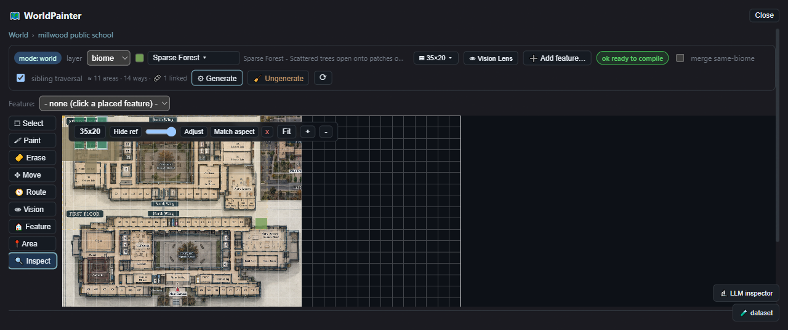
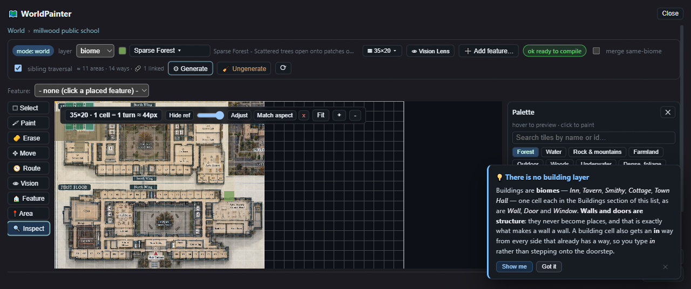
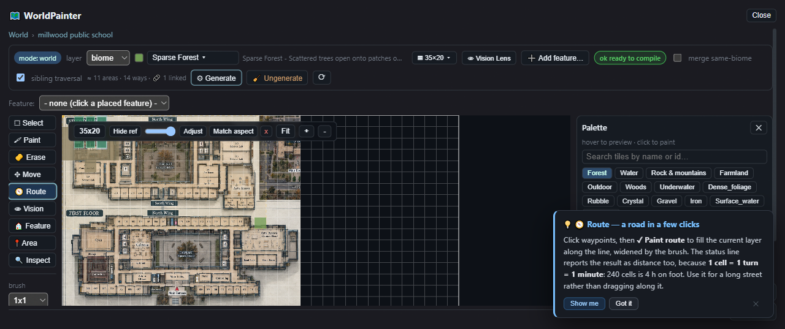
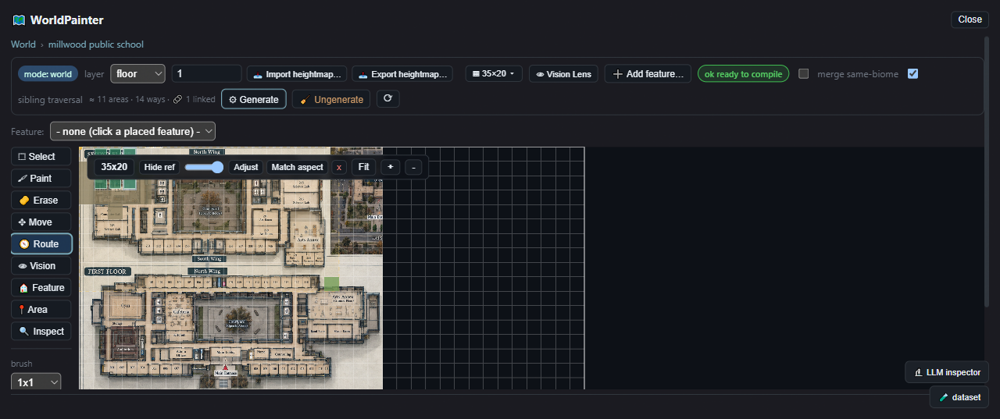
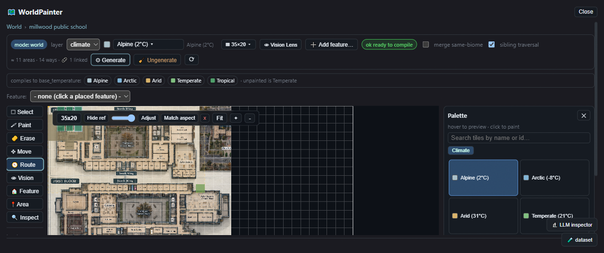
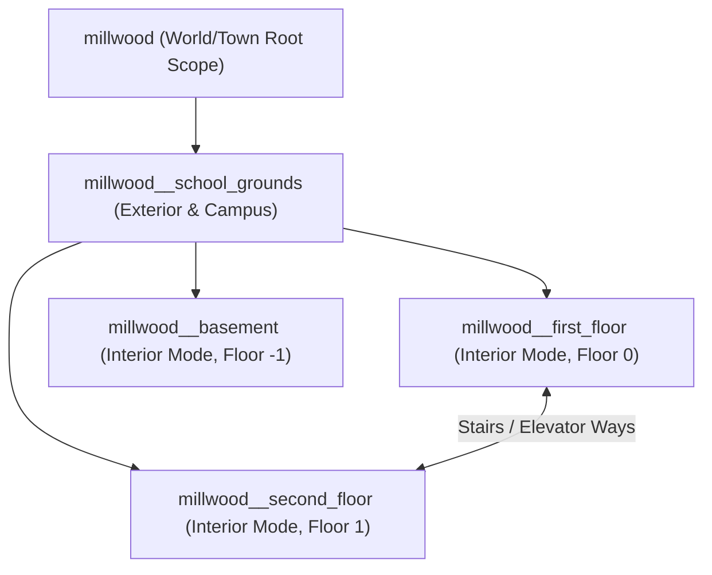

# WorldPainter Complete User Guide & Pain Points Audit

WorldPainter is VirtualWorld's recursive spatial authoring substrate. It bridges visual map painting to the underlying walkable graph (`engine/world_compile.py` -> `engine/generation.py`).

Every cell in WorldPainter represents **1 cell = 1 turn** (~44px scale, 60 turns/hour walking rate).

---

## 1. Interface Anatomy & Every Control Mapped

### Top Toolbar
| Control | Data-Role | Function | Pain Point / Audit Note |
|---|---|---|---|
| **Mode Pill** | `mode: world / settlement / interior` | Sets compile scale and boundary logic. | Changing mode after creation requires opening the grid dimensions dialog. |
| **Layer Dropdown** | `[data-role="wp-layer"]` | Toggles between `biome`, `road`, `floor`, and `climate`. | Switching layers causes a soft render and changes the available palette, but active brush value doesn't always automatically reset to a valid layer default. |
| **Active Value & Swatch** | `[data-role="wp-value"]` | Displays current paint tile name and color. Clicking opens the full Palette Dock. | Clicking the swatch vs clicking the label sometimes behaves inconsistently if the popover is active. |
| **Grid Dimensions Dropdown** | `[data-role="wp-grid-dims"]` | Shows `[35x20 v]`. Clicking opens resize, mode, presets, and auto-adjust toggle. | Dropdown previously caused vertical scrollbar jumps (fixed in task-876). |
| **Vision Lens** | `[data-role="wp-vision-lens"]` | Visualizes line-of-sight and obstruction raycasts across painted biomes. | Works on world and settlement modes, but has no live feedback indicator when toggled. |
| **+ Add feature...** | Feature creator | Spawns a new child scope (e.g. building interior or town) attached to a cell. | Prompts for name and dimensions without visually indicating gateway placement on the canvas. |
| **Compile Status Pill** | Readiness badge | Shows `ok ready to compile` or list of blockers (unlinked regions, missing biomes). | Informative, but clicking it doesn't take you directly to the offending cell. |
| **Merge same-biome** | `[data-role="wp-merge"]` | Checkbox: merges adjacent cells of identical biome into single larger Area nodes instead of 1 node per cell. | Essential for performance; when disabled on large grids, it can compile thousands of tiny nodes. |
| **Sibling traversal** | `[data-role="wp-sibling-traversal"]` | Checkbox: enables automatic bi-directional ways between sibling features on the same parent grid. | Defaults to checked, but unchecking requires full scope re-save. |
| **Node / Way Estimate** | `[data-role="wp-estimate"]` | Live compile projection: `~ 11 areas · 14 ways · 1 linked`. | Updates smoothly on every paint stroke. |
| **Generate Button** | Generation action | Compiles the painted grid into live graph `area` and `way` nodes. | One-way gate: once materialized, regenerating requires confirming overwrite. |
| **Ungenerate Button** | Rollback action | Deletes compiled nodes and returns scope state to `unmade` without losing paint data. | Clean and non-destructive to painted cells. |

---

## 2. Left Tool Rail

| Tool | Icon & Name | Shortcut | Purpose | Current Behavior & UX Flaw |
|---|---|---|---|---|
| **Select** | ⬚ `Select` | `S` | Drag marquee to select a rectangular cluster of cells. | Selection persists in client memory, but until recently you couldn't move them by dragging. |
| **Paint** | 🖌 `Paint` | `P` | Paint active tile value using configured brush size. | Primary tool. Left-click/drag paints cells immediately. |
| **Erase** | 🧽 `Erase` | `E` | Clear paint on the active layer for clicked/dragged cells. | Only clears the **active** layer (e.g. erasing on `road` leaves `biome` underneath). |
| **Move** | ✥ `Move` | `M` | Nudge selected cells across coordinates. | **Major Pain Point:** Does not allow canvas dragging! Requires clicking tiny `[^] [<-] [v] [->]` buttons on the sidebar. Dragging on canvas erroneously paints cells! |
| **Route** | 🧭 `Route` | `R` | Click consecutive waypoints to generate roads/trails with turn cost calculations. | Highly responsive; calculates total cells and hours live (60 turns/hour). |
| **Vision** | 👁 `Vision` | `V` | Test line of sight from selected cell. | Raycasts obstruction based on elevation and biome density. |
| **Feature** | 🏠 `Feature` | `F` | Pick a child scope and click a cell to place its gateway/footprint. | Placing a feature on an occupied cell prompts for displace/nesting. |
| **Area** | 📍 `Area` | `A` | Pick an unplaced hand-authored area node from graph and place it on the grid. | Shows dropdown of unplaced areas. |
| **Inspect** | 🔍 `Inspect` | `I` | Read cell details without modifying data. | **Fixed Bug:** Previously fell through to `paintAt()`, painting over cells instead of inspecting. Now correctly opens the cell detail panel and auto-scrolls to it. |

---

## 3. Reference Background Art & The Floating HUD

WorldPainter supports drawing directly over architectural blueprints, satellite photos, or hand-drawn dungeon maps:

1. **Upload Background:**
   - Click `[+ Background]` on the floating HUD.
   - Select any image (`.png`, `.jpg`, `.webp`). It is uploaded and stored in `record["reference"]`.
2. **Opacity Control:**
   - Drag the slider between `0.0` (fully transparent) and `1.0` (opaque).
   - Live Konva rendering updates in real-time.
   - **Contract rule:** Partial patches (`POST { opacity: 0.85 }`) must never wipe `image` or `rect` (fixed cleanly in `world_grid_ops.py`).
3. **Adjust Mode (`[Adjust]` -> `[Done adjust]`):**
   - Renders 8 handles (4 corner scale handles, 4 edge crop handles).
   - Corner handles scale the image across cell dimensions.
   - Edge handles crop the source window.
   - Dragging the interior moves the reference offset across the grid.
4. **Match Aspect:**
   - Auto-resizes the grid width and height to match the natural aspect ratio of the underlying blueprint image.

---

## 4. The 4 Paint Layers & How They Work

### Layer 1: Biomes (`biome`)

- **Wilderness Biomes:** `sparse_forest`, `deep_forest`, `hills`, `swamp`, `river`, `lake`, `clearing`.
- **Town / Settlement Biomes:** `street`, `alley`, `plaza`, `courtyard`, `market`, `parking_lot`.
- **Interior Biomes:** `hallway`, `room`, `classroom`, `office`, `restroom`, `cafeteria`, `gymnasium`, `stairwell`, `elevator`.
- Biomes provide ground material (`stone`, `dirt`, `wood`, `tile`), passability, forage tables, and atmospheric prose pools.

### Layer 2: Road & Trail Network (`road`)

- Painted with paths, dirt tracks, cobblestone streets, bridges, and tunnels.
- **Route Tool (`R`):** Click point A, point B, point C. Renders a continuous path and shows cell count, turn length, and real walking time (e.g. `24 cells · 24 turns · 0.4 hrs`). Click `[Apply Route]` to commit to the road layer.

### Layer 3: Floor & Verticality (`floor`)

- Storey layer (`-2, -1, 0, 1, 2, ...`).
- Represents building levels (e.g. Millwood High First Floor = 0, Second Floor = 1, Basement = -1).
- **Heightmap Import/Export:**
  - Export greyscale PNG of elevation where pixel luminance maps to meters/storeys.
  - Import heightmaps from external terrain tools to bulk-paint topography.

### Layer 4: Climate & Microclimates (`climate`)

- Maps coarse climate envelopes (`temperate`, `arid`, `frigid`, `tropical`, `subterranean`).
- Compiles directly into `base_temperature` and weather generator simulation models.

---

## 5. Multi-Floor & Recursive Hierarchy Workflow (e.g. Millwood High)

How to structure complex multi-level locations cleanly:

1. **Campus Ground Plan:** Set scope mode to `settlement`. Place outer footprint and parking lots.
2. **Child Scope Creation:** Click `+ Add feature...` -> name it `First Floor`, select `mode: interior`.
3. **Placing Gateways:** Click `Feature` tool, select `First Floor`, click on the school entrance cell.
4. **Vertical Connections:** Link floor levels using `stairwell` or `elevator` biomes with boundary overrides or manual ways.

---

## 6. Comprehensive Pain Points & UX Friction Log

During this hands-on audit and Playwright session, the following pain points were documented:

1. **Canvas Drag-to-Move is Missing (Severity: High):**
   - You cannot grab selected cells and drag them to a new spot. You are forced to click tiny `[^] [<-] [v] [->]` buttons on the sidebar, and clicking the canvas in Move mode accidentally paints.
2. **Inspect Tool Fell Through to Paint (Severity: Critical - FIXED):**
   - Clicking with Inspect previously painted over the cell. Now patched and verified with auto-scroll.
3. **Vertical Scroll Jump on Grid Controls (Severity: Medium - FIXED):**
   - The grid dimensions menu previously caused the toolbar to vertically scroll and hide buttons. Resolved with visible overflow and wrap.
4. **Reference Image Dropped on Opacity Change (Severity: Critical - FIXED):**
   - Backend `handle_set_reference` did not preserve `image` when partial patches were posted. Clean contract fix applied.
5. **No Visual Cursor Feedback on Tools (Severity: Low):**
   - When switching to Inspect or Route, the canvas cursor remains a standard pointer rather than an eyedropper, crosshair, or grab hand.
6. **Feature Placement Visibility (Severity: Medium):**
   - Creating a child scope via `+ Add feature...` doesn't automatically activate the Feature tool with that new child selected; you have to manually find it in the dropdown.
