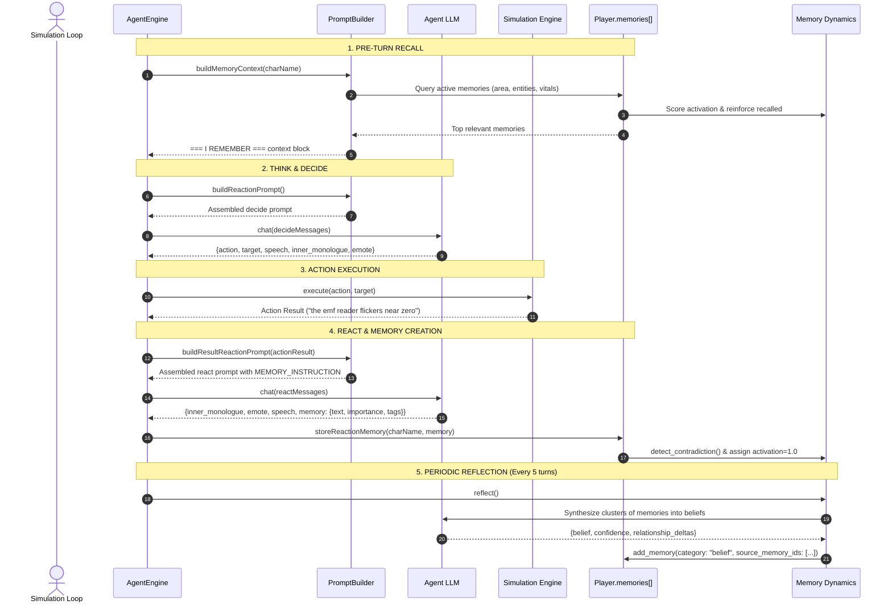
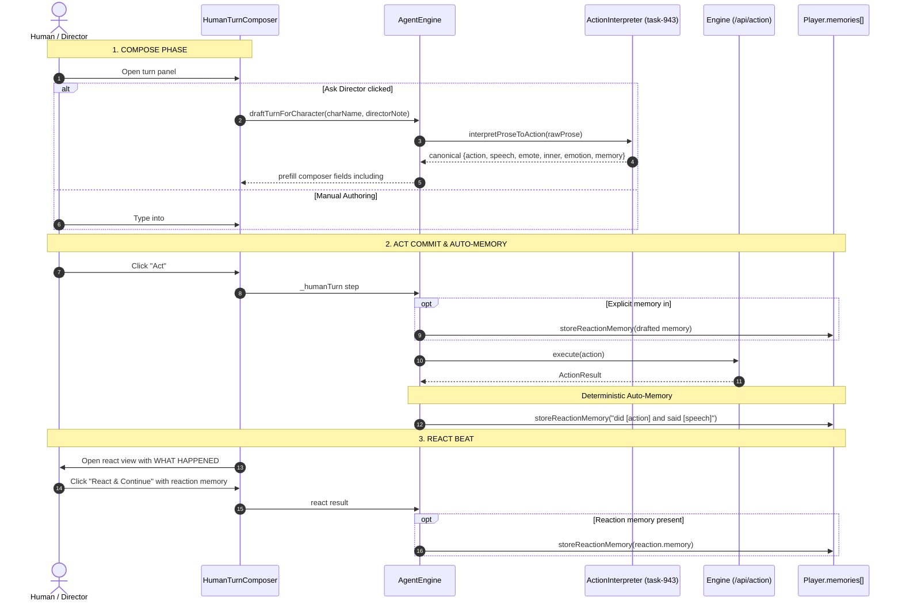
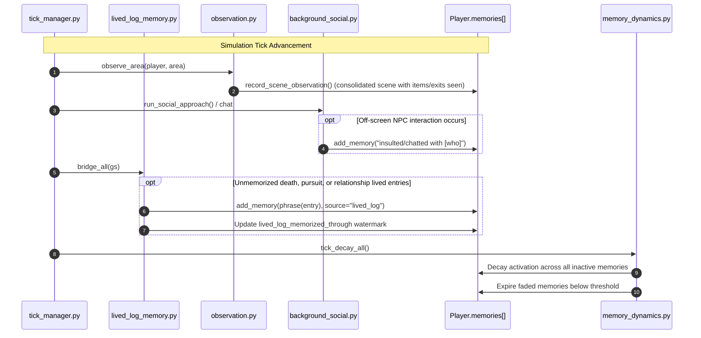

# Memory System

## What you can do

Every character carries a single, unified memory store - `Player.memories[]` - where their observations, thoughts, opinions, and reflections live together as structured entries with importance ratings, emotional tags, interpersonal relationship deltas, and entity references. The agent writes one memory per turn in its own voice (not raw action logs), and you can view, edit, search, backdate, and weave first-person memories in natural language through the Memories tab and the **🧠 Mind** dashboard (`[[Memory Weaver]]`). Memories evolve over time (`[[Memory Dynamics]]`): they decay, reinforce on recall, feed derived per-person relationship profiles, and mark contradictions rather than silently resolving them.

VirtualWorld has a **single unified memory system**: every character's memories live in
`Player.memories[]` (a structured list on the backend) and are written/read through one API
and one unified editor (`static/js/inspector/memory-view.ts`). This replaced four parallel
systems (backend kv-store, browser-localStorage `MemoryStore`, `EntityIndex`, and
`world_knowledge`) in **task-178**.

## The One Store

All memory lives in `Player.memories[]` - a list of entries. Serialization round-trips it
(`engine/serialization.py`). The unified Memory Weaver & Editor, the agent engine, and the
MCP memory tools all operate on this same list.

### Memory schema

```json
{
  "id": "mem_...",
  "text": "subjective 1-3 sentence takeaway",
  "type": "observation|action|speech|thought|reflection|reaction|emote|location|...",
  "category": "episodic|belief|social|procedural|semantic",
  "tick": 128,
  "timestamp": 1750000000,
  "importance": 7,
  "confidence": 0.9,
  "activation": 1.0,
  "reinforcements": 0,
  "location": "Living Room",
  "entity_ids": ["area_living_room"],
  "embedding": null,
  "tags": ["door", "rel:valerius", "trust:-2"],
  "emotion": {"label": "afraid", "intensity": 6},
  "memory_emotions": [{"label": "embarrassed", "intensity": 4}, {"label": "aroused", "intensity": 7}],
  "relationship_deltas": [{"who": "Valerius", "why": "locked the door", "data": {"trust": -2, "fear": 3}}],
  "salience_override": 0,
  "source": "auto|manual"
}
```

- `source` is `manual` for editor-added / seeded backstory (rendered with a **SEED** badge),
  `auto` for everything the agent generates at runtime.
- `tags` are **single-word conceptual categories** (fear, trust, mystery, amnesia) plus
  structured `rel:<slug>` and `dim:delta` relationship markers (`trust:-2`, `respect:3`).
  `_sanitizeTags()` (`static/js/agent/memory-manager.js`) drops multi-word/hyphenated plain tags
  (`silent-stranger`) and any plain tag matching a known player/item/area name before storing.
  New conceptual tags are auto-registered into the **tag library** (id-keyed files in
  `data/library/tags/`). See [[Library System/Tags System]].
- `emotion` is the **primary** single emotion (backward-compatible with the engine spike path).
- `memory_emotions` is the **full list** of emotions attached to this memory
  (`[{label, intensity}]`) - the richer, multi-emotion form the editor/weaver writes. Recall
  re-feels **all** of them, not just the primary.
- `relationship_deltas` (`[{who, why, data}]`) stores per-person interpersonal shifts across
  `trust`, `fear`, `attraction`, `disgust`, and `respect` (`-5..+5`), allowing a single memory
  to affect multiple people without cross-applying deltas (`engine/derive.py`).
- `salience_override` (0-10) is a manual recall-boost; >0 shows a **⚡ salience** badge.
- `tick` is the time the memory was created. A **negative** tick means *before the scenario
  started* - the Weaver's **"When did this happen?"** field (or **"Turns before start"**) writes
  `tick = -N` to represent a pre-scenario or backdated memory.

## Who writes memories

There are **16 distinct memory-writing paths** across the frontend and backend:

| Writer | Where | Type / Category | Description |
|---|---|---|---|
| **Agent react phase** | `agent-engine.ts:1755` | `reaction` (episodic) | LLM-generated subjective takeaway after action resolution |
| **Agent non-reactive phase** | `agent-engine.ts:1804` | `reaction` (episodic) | Single-phase turn-end memory (opt-in via `config.endOfTurnMemory`) |
| **Deterministic auto-memory** | `agent-engine.ts:559` | `reaction` (episodic) | Instant, LLM-free memory generated on every action execution: `did X and said Y` |
| **Composer draft memory** | `agent-engine.ts:558` | `reaction` (episodic) | Explicit memory drafted in `#htc-memory` during Compose phase and committed on Act |
| **Composer react beat** | `agent-engine.ts:610` | `reaction` (episodic) | Post-action reaction memory entered in `HumanTurnComposer.react()` |
| **Wake from unconsciousness** | `agent-engine.ts:1423` | `thought` (episodic) | Disorientation memory generated on wake from 0 energy |
| **Action Interpreter** | `action-interpreter.ts` | canonical `memory` | Extracts personal memory reflections from creative roleplay prose (task-943) |
| **Lived log memory bridge** | `lived_log_memory.py` | `observation` (episodic) | Tick-advancement bridge phrasing deaths, pursuits, and relationships into memories (task-727) |
| **Scene observations** | `observation.py` | `observation` (episodic) | Consolidated `scene_observed` memory per room visit, reinforced in place on revisit (task-789) |
| **Background social simulation** | `background_social.py` | `social` (social) | NPC-to-NPC conversations, approaches, insults, and flirtations with relationship deltas |
| **Trigger effects** | `effect_handlers/memory.py` | author-defined | World triggers firing `add_memory` or `remove_memory` on examine/use/enter (task-198) |
| **Direct action handlers** | `routes/action_handlers.py` | `action` / `social` | Whispers, trades, and direct interpersonal actions writing memories to actor and target |
| **Timeskip milestones** | `timeskip.py` | `observation` (episodic) | Multi-hour/day timeskip summaries for major world events |
| **Memory Weaver & Editor** | `inspector/memory-view.ts` | user-selected / woven | Manual creation, backdating (`simulate_age_decay`), opinion asking, and relationship weaving |
| **Seeds and backstory** | `character_store.py` | `observation` (manual) | Initial backstory memories seeded from character bio, secrets, and media |
| **Commons chat agent** | `commons-agent.ts` | `conversation` | Chat and town board messages stored via the `remember` tool |

### Speech in memories: what the engine actually does

Historical documentation claimed that characters do not remember spoken dialogue. In reality:
- **In Human / Directed turns (`agent-engine.ts:563`):** Every action commit automatically writes spoken lines into deterministic auto-memory (`said "${step.speech}"`), ensuring dialogue commitments persist.
- **In Autonomous Agent loops:** The think-decide phase currently does not automatically commit speech to memory unless the model explicitly reflects on what it said in the react phase, which can lead to dialogue repetition if the model ignores the prompt conversation window.

## Architecture & Data Flow

```mermaid
flowchart TD
    subgraph WRITERS["Memory Writers (16 Distinct Sources)"]
        W1["1. Human Composer Draft (#htc-memory)"]
        W2["2. Deterministic Action Auto-Memory (did X, said Y)"]
        W3["3. Human Composer React Beat"]
        W4["4. Agent LLM React Phase (buildResultReactionPrompt)"]
        W5["5. Agent Single-Phase (endOfTurnMemory)"]
        W6["6. Wake from Unconsciousness"]
        W7["7. Action Interpreter (task-943)"]
        W8["8. Lived Log Memory Bridge (task-727)"]
        W9["9. Scene Observations (task-789)"]
        W10["10. Background Social Simulation"]
        W11["11. World Triggers (add_memory)"]
        W12["12. Direct Action Handlers (whispers/trades)"]
        W13["13. Timeskip Milestones"]
        W14["14. Character Bio / Secret Seeding"]
        W15["15. Inspector Memory Weaver & Editor"]
        W16["16. Commons Chat Agent (remember)"]
    end

    subgraph CLIENT_API["Client & HTTP Layer"]
        AM["AgentMemory.storeMemory()"]
        AC["ApiClient.addPlayerMemory()"]
        EMB["EmbeddingClient.embed()"]
        REST["POST /api/players/{name}/memories/entry"]
    end

    subgraph STORAGE["Authoritative Storage & Dynamics"]
        STORE[("Player.memories[]")]
        DYN["engine/memory_dynamics.py<br/>(activation decay, contradiction linking, reinforcement)"]
        VEC[("engine/vector_store.py<br/>(cosine embeddings)")]
        SER["engine/serialization.py<br/>(persisted to scenario/save)"]
    end

    subgraph READERS["Memory Consumers & Query Paths"]
        R1["PromptBuilder.buildMemoryContext()<br/>(Pre-turn recall injected into === I REMEMBER ===)"]
        R2["engine/memory_retrieval.py<br/>(Multi-channel associative scorer)"]
        R3["engine/derive.py<br/>(Derived per-person relationship profiles)"]
        R4["Inspector Mind Panel<br/>(Timeline, connections, lived evidence)"]
        R5["AgentMemory.reflect()<br/>(Periodic belief synthesis every 5 turns)"]
    end

    W1 -->|Act commit| AM
    W2 -->|Immediate step commit| AM
    W3 -->|React & Continue| AM
    W4 -->|React response| AM
    W5 -->|End-of-turn| AM
    W6 -->|Wake event| AM
    W7 -->|Interpreted prose| AM
    W15 -->|Manual save/weave| AC
    W16 -->|Tool call| AC

    AM --> AC
    AM -.->|Vectorize| EMB -.-> VEC
    AC --> REST --> STORE

    W8 -->|bridge_all()| STORE
    W9 -->|record_scene_observation()| STORE
    W10 -->|player.add_memory()| STORE
    W11 -->|on_examine/on_use| STORE
    W12 -->|player.add_memory()| STORE
    W13 -->|player.add_memory()| STORE
    W14 -->|to_player()| STORE

    STORE <--> DYN
    STORE <--> SER

    STORE --> R1
    STORE --> R2
    STORE --> R3
    STORE --> R4
    STORE --> R5
    R5 -->|synthesize insight| REST
```

## Sequence Diagrams

### Sequence 1: Autonomous Agent Turn (Think -> Act -> React)



### Sequence 2: Human & Director Composer Turn



### Sequence 3: Simulation Tick & Background Passive Bridging



## Memory API

`routes/memories.py`:

| Method | Endpoint | Description |
|---|---|---|
| GET | `/api/players/<name>/memories` | List all memories |
| PUT | `/api/players/<name>/memories` | Replace all memories |
| POST | `/api/players/<name>/memories/entry` | Add a memory entry (supports `relationship_deltas`, `simulate_age_decay`, `derived_expectation`) |
| POST | `/api/players/<name>/memories/entry/<id>` | Update a memory entry |
| DELETE | `/api/players/<name>/memories/entry/<id>` | Delete a memory entry |
| POST | `/api/players/<name>/memories/clear` | Clear all memories |
| POST | `/api/players/<name>/memories/retrieve` | Score + return most relevant memories (supports `structured: true`) |
| POST | `/api/players/<name>/memories/reflect` | Store structured LLM insights as `belief` / `procedural` / `social` memories |
| POST | `/api/players/<name>/memories/context` | Non-mutating grounding packet + live contradiction & `derive.py` relationship preview for the [[Memory Weaver]] |
| GET | `/api/players/<name>/memories/people` | Derived per-person relationship profiles (`trust`, `fear`, `attraction`, `disgust`, `respect`) |
| GET | `/api/players/<name>/memories/spatial` | KNOWN ROUTES block (BFS over `visited_areas`) |

## Frontend

### `static/js/agent/memory-manager.js`

`window.AgentMemory`:

- `storeMemory(charName, text, importance, type, tick, entity_ids, tags)` - POSTs to the
  backend `/memories/entry`. Fire-and-forget. Also registers any new tags into the library.
- `reflect(charName)` - fetches memories (importance >= 6, `reflection_depth == 0`), asks the
  LLM for structured insights, and POSTs them to `/memories/reflect`. Runs every 5 turns in
  reactive mode. No `world_knowledge` blob anymore.

### `static/js/inspector/memory-view.ts` & `static/js/inspector/mind-view.ts`

The inspector Memories tab and the **🧠 Mind** dashboard render `Player.memories[]` directly:

- Importance-colored left border (red >= 8, orange >= 6, green >= 4, grey otherwise)
- **SEED** badge for `source: manual`
- Category chip, confidence %, `×N` reinforcement badge, and `⚡ contradicts` badge
- Tag chips (`#tag`) + emotion chips (from `memory_emotions`)
- Edit / delete per entry; `+ Add`, `✨ Weave / Gen`, and `Clear All` buttons

### ✨ Memory Weaver & Unified Editor (`task-730`)

The **`✨ Weave / Gen`** button, **`+ Add`**, **`✏️` Edit**, the Mind panel's mode buttons
(`💬 Ask Opinion`, `🕰️ Backdate Event`, `🤝 About Person`), double-clicking any point on the
SVG timeline (`#mind-timeline-svg`), and clicking **`🤝 Weave Memory`** on a person card in the
Mind panel's **People** tab all open the unified **Memory Weaver & Editor** modal
(`InspectorMemory.openWeaver`):

- **Three Natural-Language Modes**:
  - **`💬 Ask Opinion / Reaction`** (`type: thought`, `category: belief`) - ask what the character thought of a movie, book, rumor, or event.
  - **`🕰️ Backdate Event`** (`type: observation`, `category: episodic`) - plant a memory at any relative time (`"30 minutes ago"`, `"yesterday"`, `"3 years ago"`, `"100 turns before start"`, `"tick -250"`) with optional natural age-decay simulation (`simulate_age_decay`).
  - **`🤝 About a Person`** (`type: observation`, `category: social`) - weave a shared moment or impression involving one or more characters, populating multi-person `relationship_deltas` (`trust`, `fear`, `attraction`, `disgust`, `respect`).
- **Context-grounded first-person drafting**: Uses `POST /api/players/<name>/memories/context` to ground the LLM in the character's persona, existing memories, derived relationship profiles, and world entities without reinforcing or mutating state, and sanitizes third-person editorial leakage (`stripEditorialLeakage`). Supports multi-turn refinement (`↻ Refine`).
- **Live Relationship & Contradiction Previews**: Displays `before -> after` bars from `engine/derive.py` and structural contradiction warnings from `engine/memory_dynamics.py:detect_contradiction` as you edit, before you save.
- **Optional Derived Expectation & Counterpart Memory**: Can automatically save a linked `category: "procedural"` behavioral expectation and/or plant the counterpart perspective memory on the other character.

See **[[Memory Weaver]]** for the full user guide, how-to, and current boundaries.

## Memory emotion recall (residue)

When an emotionally-tagged memory surfaces, it re-feels a fraction of what it carried. Two paths:

1. **Self-recall** - `memory-context.js::_respikeFromMemories` fires while your own recall block is
   built; it re-feels every attached `memory_emotions` (affect map + subtle vital).
2. **Social recall** - `room-context.js::_fireSocialRecall` fires when another character *says
   something that touches one of your memories*; it re-feels it, and (when the speaker is a known
   person) also nudges your relationship toward them. An anonymized voice ("a woman's voice") still
   re-feels but attributes no relationship.

Both go through `POST /api/players/<name>/emotions/map`. See
[[Characters/Emotion & Affect System]] for the dimension map, semantic label mapping, vital
coupling, and relationship valence.

## Spatial memory (separate, task-136)

`visited_areas`, `discovered_items`, `discovered_exits` are persisted on the player
(`serialization.py`) and power the `KNOWN ROUTES` prompt block via `engine/spatial_memory.py`
(BFS over the real graph, seeded from `visited_areas`). These are discovery state, not
memories - do not confuse them with `Player.memories[]`.

## What was deleted (task-178)

- `engine/agent_memory.py` (`AgentMemory` kv-store) - dead code, zero callers
- `static/js/memory-store.js` (browser localStorage embeddings) - the agent's real recall
  work lived invisibly per-browser
- `static/js/entity-index.js` (`VW.entityIndex`) - regex extractor producing junk entities
- `Player._memory`, `Player.knowledge`, `Player.world_knowledge` - dead/duplicate fields

## Context window management

`ContextWindowManager` (`static/js/context-window.js`) prunes the per-character conversation
history. AgentEngine config: `maxTokens: 9500, maxMessages: 30, recentTurnCount: 6`.

- History grows ~4 messages/turn (think-decide user+assistant, react user+assistant)
- Prune triggers >30 messages or >9500 tokens (~5-7 turns)
- Prune keeps: system message + last `recentTurnCount * 3` (18) messages; older turns
  replaced with `[Summary: N earlier turns omitted.]`
- **History is NOT reset per turn** - it persists across turns and is only cleared on
  `start()`/`reset()`. The LLM-generated `memory` field is the durable record once old
  messages get summarized away.

## Memory dynamics (task-685)

Memories are no longer static entries. Every memory carries optional dynamics
fields - `category` (episodic/semantic/procedural/social/belief), `activation`,
`confidence`, `reinforcements`, `last_recalled_tick`, `reflection_depth`,
`source_memory_ids`, `contradicts` - owned by `engine/memory_dynamics.py`:

- **Recall reinforces** - every retrieval path (the `/memories/retrieve`
  endpoint, `Player.get_relevant_memories`, `AgentMind.recall`, and the
  client's vector-search merge via `POST /memories/reinforce`) stamps
  bounded reinforcement instead of the old unbounded +1-importance ratchet.
- **Re-encounter reinforces** - a near-verbatim memory written days later
  strengthens the original instead of appending (extends the task-346 dedup).
- **Decay is non-uniform** - `activation` fades with per-memory resistance
  (importance >= 8, strong emotions, reinforcements, and concluded/semantic
  categories resist); unimportant faded memories are removed, important ones
  never are. Rate: the `memory_decay_per_tick` trait, or the
  `memory.decay_per_tick` config default (0.01; 0 freezes).
- **Reflection changes the character** - `reflect()` asks for structured
  insights (belief + confidence + optional emotional association, behaviour
  expectation, relationship delta) and stores them as depth-1 `belief` /
  `procedural` / `social` memories with `source_memory_ids` provenance;
  `rel:`/`dim:` tags feed the `derive.py` per-person profiles directly.
  Reflections of reflections are refused (depth guard, client and server).
- **Contradictions are marked, never resolved** - an assert/deny pair sharing
  an entity is linked in `contradicts[]` and the older side loses a little
  confidence; the prompt says "you are not sure".

Full design: [[Memory Dynamics]]. User guide for natural-language memory
authoring and backdating: [[Memory Weaver]]. Status: implemented and wired
(endpoint + tick + prompt paths tested in `tests/test_memory_dynamics.py` and
`tests/test_memory_weaver.py`), including the **Memory Mind** dashboard
(`static/js/inspector/mind-view.ts`, opened from the 🧠 Mind button - timeline,
filters, connections, underlying record & lived-log evidence inspector, and
per-person derived profiles via `GET /api/players/<name>/memories/people`).

## Related

- [[Memory Weaver]]
- [[Memory Dynamics]]
- [[dev_tasks/done/characters/task-178-unify-memory-systems|task-178: Unify memory systems]]
- [[dev_tasks/done/prompting/task-160-parameterized-actions-in-prompts|task-160: Parameterized actions (LLM memory field)]]

<!-- changelog:start -->
## Changelog

*Generated by `python tools/page_changelog.py` from the task cards whose `wiki:` points at this note. Never hand-edit inside the markers.*

| When | Task | Status |
|---|---|---|
| - | [[task-96-emotional_residue_intercharacter_memory\|task-96-emotional_residue_intercharacter_memory]] | `done` |
| - | [[task-91-activate_cosine_similarity_retrieval\|task-91-activate_cosine_similarity_retrieval]] | `done` |
| - | [[task-42-proper_memory_editor\|task-42-proper_memory_editor]] | `done` |
| - | [[task-37-memory_context_relative_time\|task-37-memory_context_relative_time]] | `done` |
| - | [[task-178-unify-memory-systems\|task-178-unify-memory-systems]] | `done` |
<!-- changelog:end -->

## Where it lives

- **`Player.memories[]`** (`player.py`) - the unified memory list on the character model
- **`engine/serialization.py`** - serializes/deserializes the list on save/load
- **`routes/memories.py`** - full REST API (`/api/players/<name>/memories/*`)
- **`engine/derive.py`** - per-person relationship profile derivation (`derive_person_profile`, `fold_emotions_into_profile`)
- **`static/js/agent/memory-manager.ts`** (`window.AgentMemory`) - `storeMemory()`, `reflect()`
- **`static/js/inspector/memory-view.ts`** - Memories tab with unified Memory Weaver & Editor modal, dynamics badges
- **`static/js/inspector/mind-view.ts`** - Memory Mind dashboard (timeline, filters, connections, record & lived-log evidence, People tab)
- **`engine/memory_dynamics.py`** - decay, reinforcement, contradiction, and category dynamics
- **`engine/spatial_memory.py`** - `visited_areas` BFS for KNOWN ROUTES
- **`static/js/context-window.js`** - per-character conversation history pruning
- **`mcp_server.py`** - MCP memory tools

<!-- connected:start -->
## Connected

*Generated by `python tools/doc_connected.py --apply`  -  relations the repo already asserts (Feature Map rows, task `wiki:` frontmatter, module `@docs` headers, same-folder notes), not invented.*

**Read next**  -  [[Memory Dynamics#5. Query-driven retrieval]]

**Features**  -  [[memory|Memory]] (#22), [[memory-pipeline|Memory pipeline]] (#41)

**Dev tasks**  -  [[dev_tasks/cancelled/task-26-vector_embeddings_rag_prep|task]], [[dev_tasks/done/characters/task-178-unify-memory-systems|task]], [[dev_tasks/done/characters/task-37-memory_context_relative_time|task]], [[dev_tasks/done/characters/task-42-proper_memory_editor|task]], [[dev_tasks/done/characters/task-908-associative-memory-retrieval-3-0-multi-facet-perceptual-cues-and-zero-padding-prompt-lanes|task]], [[dev_tasks/done/characters/task-91-activate_cosine_similarity_retrieval|task]] … +5 more

**Neighbouring notes**  -  [[Agent Engine]], [[LLM Providers]], [[Memory Dynamics]], [[Memory Weaver]], [[Narration System]], [[Turn-Based System]]

<!-- connected:end -->
