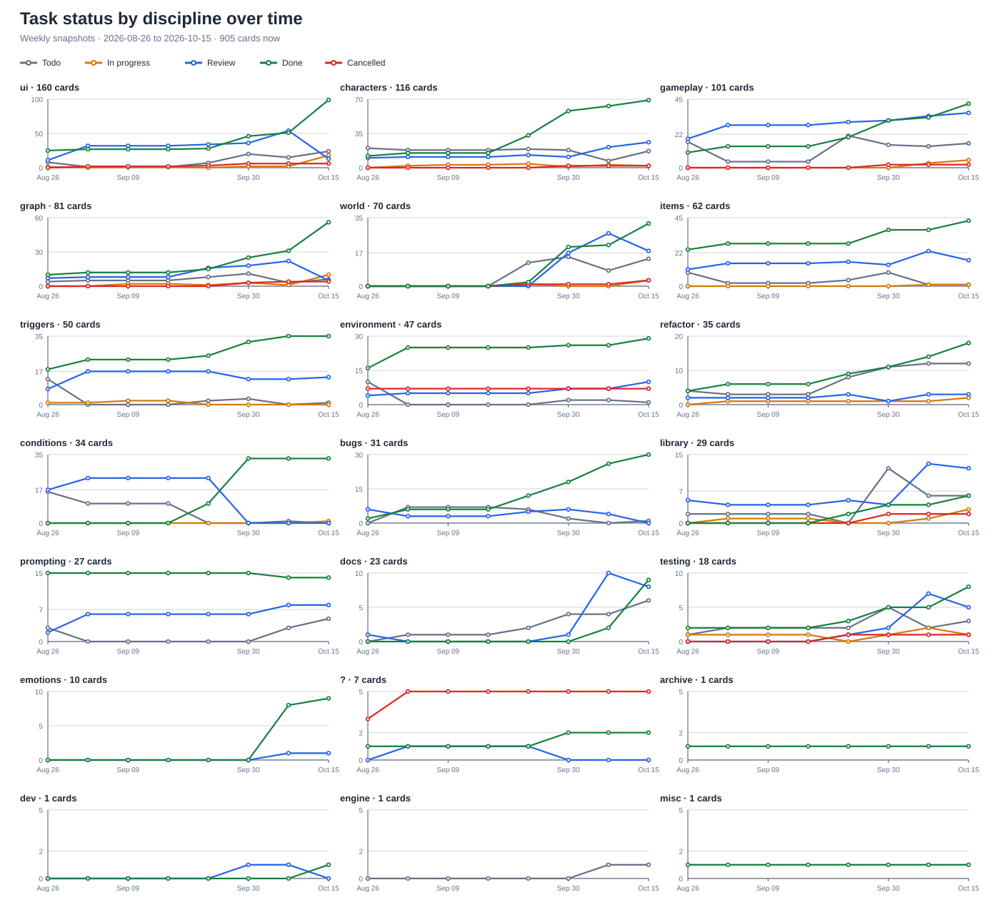

# VirtualWorld Engine

VirtualWorld is a local, single-player world simulation driven by AI agents. It uses Flask and a browser front end, has no cloud dependency, and can connect to a local model (such as Ollama or LM Studio) or another OpenAI-compatible provider. The app also runs without an LLM provider; agent thinking then remains unavailable.

**Project snapshot: 2026-10-15.** The project is active and under development. The counts and statuses below describe the current repository and task tracker on this date.

## What the project models

The graph is the authoritative world model: areas, ways, items, characters, and their typed relationships. Scopes and map or grid views help organize and author that graph; they are not a second simulation world. Movement and actions resolve through the authored connections and rules.

Characters share one simulation scale. A human, a simple NPC, a background-simulated character, and an LLM-driven agent differ in how much cognition they use, not in what the world lets them do. Character identity is an opaque ID; display names are for people and matching. Runtime state such as needs, memories, emotion, plans, and traits belongs to the `Player` model.

## What it feels like to use

VirtualWorld is a world you can author, step into, and fast-forward through. Its central promise is that the setting has state beyond the latest AI response: places and connections determine where someone can go; objects and actions change the world; and time, weather, light, temperature, needs, and character state continue to matter as play advances.

The engine resolves the world tick. A human or an AI agent supplies decisions for the characters receiving close attention; deterministic background simulation handles routine actions for characters farther from the scene. An LLM can help decide and narrate, but it does not get to silently rewrite the graph to make a story beat true. Without a configured LLM, the simulation still runs, while agent thinking is unavailable.

For example, author a village with a road, a tavern, and a few residents. A storm changes the outside conditions; an open door lets light and heat pass between rooms; a tired character may seek rest while another keeps a schedule. You can enter a scene and act, or request a timeskip with an intent such as travel or leisure. The world processes that span and returns control when something relevant interrupts it. The natural-language editor can help add or change world entities, showing staged edits and a diff before you apply them.

### The world keeps moving

**Backsim** is the low-cost background layer for characters outside the immediate scene. It handles routine needs, travel, schedules, and social encounters on the same clock and world graph as foreground play. A character can spend a quiet stretch doing nothing if their needs are met; background activity is there to make the world persist, not to generate noise every tick. Its core path is wired, while authored long-term pursuits remain limited.

**Timeskips** let you hand a character an intent and a span-idle, leisure, search, explore, or travel-rather than issuing every small action. Time advances through the ordinary simulation, so needs and environmental consequences still apply. A relevant event or a blocked intent can stop the skip and return control with an explanation. Timeskips are working; follow-up work on intent outcomes and multi-character spans is in review, with longer-span extensions still planned.

**Weather, temperature, and light** are interacting parts of that simulation. Forecasts can be authored or rule-driven; a per-area generator in review uses a seed, season, terrain, climate, and neighboring areas to shape local conditions. Weather affects temperature, wind, humidity, snow, daylight, movement, and foraging. Heat sources warm rooms, temperatures flow through open connections, and wind and clothing change how cold or hot a character feels. Light shifts with time, weather, moon, and lamps; it can limit actions in darkness and sustained darkness can affect sanity. The core environment systems are wired; the generated forecast interface is also in review, and a graph heat-overlay issue remains in progress.

### Characters and world editing

**The Commons** is a messaging space for the world's existing characters: public conversation, private groups, and direct messages. Membership and read state are enforced per character, and conversations persist with the world. It gives the cast a shared communication surface; autonomous Commons conversations have not yet been integrated into the standard AgentEngine turn path, so that part is still in progress.

**The natural-language editor** turns a request into proposed operations on the world graph. It can inspect the world and content library, create or update entities, connect areas, and stage other supported edits. A staged tray, graph preview, and property-level diff let you inspect the intended changes; validation runs before Apply, which records the batch as one undoable transaction. The editor is working, with additional authoring operations in review and model-specific tool-call reliability still being addressed.

### GIMP and MOSIAC: what a character wants, and what matters now

**GIMP** is the authored goal layer. It records a character's **Goal** (what they want), **Intention** (why this particular goal matters), **Motivation** (the underlying drive), and **Pursuit** (how they might work toward it). Goals can have status, deadlines, blockers, and success conditions tied to world facts. The purpose is to give a character continuity across scenes: “become the village chief” can matter after today's conversation has ended.

**MOSIAC** is the per-character decision context for the present moment: **Motivation**, **Obligations**, **Schedules**, **Intentions**, **Attention**, and **Choices**. It gathers standing aims and duties alongside immediate signals such as needs, danger, and the actions currently available. In the Mind panel and agent prompt, it helps answer “what is this character weighing right now?” GIMP holds the longer-term wants; MOSIAC assembles the context used to decide what deserves attention now.

These are not yet a finished autonomous-goal loop. Goal records and MOSIAC context assembly exist, and the context is shown in the Mind panel and included in the agent prompt. Goal editing/history and disposition scoring work are in review. The selector that binds goals, needs, memory, and personality to a pursuit-and the generic executor for those plans-remain unfinished. The current implementation should therefore be described as a working goal/context foundation, not as characters already pursuing rich long-term goals end to end. See [GIMP](docs/virtualWorld/Characters/GIMP.md), [MOSIAC](docs/virtualWorld/Characters/MOSIAC.md), and the task cards for [goal selection](docs/virtualWorld/dev_tasks/todo/characters/task-704-mosiac-selector-needs-memory-and-personality-choose-and-bind-plans.md) and [plan execution](docs/virtualWorld/dev_tasks/todo/gameplay/task-702-plan-executor-runtime-the-engine-runs-typed-plans-for-any-character-with-invalidation-and-needs-override.md).

### Where VirtualWorld fits

These tools solve different problems. VirtualWorld's particular focus is a persistent, rule-resolved world that can be authored and simulated:

| Tool | Main focus | How VirtualWorld differs |
|---|---|---|
| [Unity](https://unity.com/products/unity-engine) | A general-purpose engine for building and shipping 2D/3D games and applications. | VirtualWorld starts with a browser-based world simulation and authoring workflow. It is narrower than Unity and does not provide Unity's general 3D production and deployment pipeline. |
| [AI Dungeon](https://help.aidungeon.com/faq/the-basics) | An AI-generated text adventure directed by the player, with scenarios, story cards, and scripting. | VirtualWorld emphasizes an explicit world graph and engine-resolved actions and environmental state alongside generated narration. The distinction is the center of gravity, not a claim that AI Dungeon lacks structured authoring. |
| [SillyTavern](https://docs.sillytavern.app/) | A configurable LLM chat frontend with character cards, group chats, and extensions. | VirtualWorld puts the shared setting and simulation at the center: geography, movement, time, environment, and character state are modeled as part of play. |
| [Character.AI](https://support.character.ai/hc/en-us/articles/50608869548699-2-Creating-a-Character-Quickstart-Guide-%CF%89) | Creating, discovering, and chatting with AI characters. | VirtualWorld focuses on characters inhabiting one persistent simulated world, where their actions take place in the same setting and state model. |

Its useful distinction is not “more AI.” It is that an authored world can keep making coherent, inspectable changes when the player advances time, leaves a room, or asks for an edit.

## Features and system status

The [feature catalogue](docs/virtualWorld/Features/Features%20Overview.md), updated 2026-10-15, lists **78 features: 75 wired, 2 planned, and 1 unwired**. “Wired” means the catalogue records a runtime path; it is not a claim that every edge case has been manually verified. See the linked feature and system pages for behavior and limits.

| System | Status | Current capabilities |
|---|---|---|
| World graph and map | Wired | Areas, ways, items, characters, typed edges, scopes, graph and map layouts, and WorldPainter authoring. The graph remains the source of truth. |
| Scenario and world authoring | Wired | Scenario creation, inspectors, way and trigger/effect editors, library and library sync, natural-language editing and generation, validation, recent edits/undo, and save/load. |
| Turn and action simulation | Wired | Runtime turn queue, human turns, sequential/random/initiative modes, turn-based action composition, movement, examination, object interaction, combat, speech, search/forage, and time skips. |
| Characters and behavior | Wired | Character needs and vitals, conditions, traits and skills, emotion, relationships, memory, activities, NPC behavior, agent cognition levels, and background simulation. |
| Character goals and decision context (GIMP / MOSIAC) | Foundation wired; goal-driven pursuit selection unfinished | Goal records and serialization exist; MOSIAC context is assembled for the Mind panel and agent prompt. Goal editing/history and disposition scoring are in review; the selector and generic plan executor remain unfinished. |
| Environment and time | Wired | World clock, weather and forecast, sky, temperature, and light systems. |
| Observation and diagnostics | Wired | Event stream, event export, agent overview, soak lab, validator/issues, and bug reporting. |
| The Commons | Core flows wired; agent integration in progress | Public, private group, and two-person direct-message conversations; server-side membership checks, per-character/per-conversation read cursors, and world-save persistence. The UI flows are documented as browser-checked. Autonomous chat decisions still use a communication-only loop rather than the standard AgentEngine turn path; scenario authoring and export also have limits. |
| Per-agent knowledge / fog of war | Unwired | The feature catalogue marks this unwired; its reveal producer is not connected to the runtime path. |
| Agent behavior settings; graph settings | Planned | These are the two planned entries in the feature catalogue. |

The catalogue also marks **Crafting** as wired, but it does not yet have a dedicated feature page or deep documentation. The Feature Ledger and dated overview list 78 features, including The Commons; the checked-in generated `docs/design/feature-index.md` is stale at 77 entries and does not yet include The Commons. Run `python tools/feature_index.py --report` to read the current ledger and module mapping.

## Task tracker and progress

The task tree is under `docs/virtualWorld/dev_tasks/`. The status folder is authoritative; `review` means pending review, not completed. Counts below come from `python tools/tasks.py status --json` and `python tools/tasks.py list`.

There are **905 cards**: **827 tasks** and **78 bugs**. **537 are marked done** (59.3% of all cards). The rest are in review, in progress, todo, or cancelled.

| Status | Cards | Share |
|---|---:|---:|
| Done | 537 | 59.3% |
| Review | 176 | 19.4% |
| In progress | 46 | 5.1% |
| Todo | 114 | 12.6% |
| Cancelled | 32 | 3.5% |
| **Total** | **905** | **100%** |

Shares are rounded to one decimal place.

### Task status by discipline over time

Each panel is one tracker area. The lines show task and bug card counts in each status at weekly snapshots. The history starts with the first tracked task-tree snapshot on 2026-08-26; the final point is the current working tree on 2026-10-15. Each panel has its own count scale.



The chart is generated from Git status-folder history and checked against the current task tracker totals. Regenerate it with `python tools/task_progress_chart.py --as-of YYYY-MM-DD`.

## Repository size

Measured on 2026-10-15 with `scc`. These are repository line counts, not estimates of feature completeness.

| Content | Files | Lines | Counting method |
|---|---:|---:|---|
| Code | 894 | 213,297 code lines; 291,832 total lines | Python, TypeScript, standalone JavaScript, HTML, and CSS. Code lines exclude blanks and comments. Includes tests and tools; excludes emitted JavaScript when a matching TypeScript source exists. |
| Documentation | 1,181 | 149,891 | Physical Markdown lines in `docs/`, root project guides, and `tools/README.md`; includes task cards. |
| Structured data | 4,000 | 2,404,621 | Physical JSON/JSONL lines under `data/` and `saves/`, plus `world_template.json`; binary assets are not counted. |

To reproduce the code count, run `scc` over the repository with Python, TypeScript, HTML, and CSS extensions, then count standalone JavaScript files separately so emitted TypeScript output is not double-counted. The documentation count covers project guides and `docs/`, excluding root session logs; the data count covers JSON/JSONL content in `data/`, `saves/`, and `world_template.json`. All counts exclude dependency folders and local caches such as `.git`, `node_modules`, `.venv`, and `.kilo`.

## Quick start

```bash
pip install -r requirements.txt
python app.py
```

Open <http://127.0.0.1:4444>. On Windows, `start.bat` starts the app. Configure an LLM provider in Settings to enable agent thinking; local providers are supported.

## Useful commands

| Task | Command |
|---|---|
| Run the app | `python app.py` |
| Run one targeted Python test file | `python -m pytest tests/test_<name>.py` |
| Run the JavaScript unit tests | `node tools/unit/run.cjs` |
| Check front-end modules and gates | `python tools/ts_convert.py check` |
| Check task status | `python tools/tasks.py status --json` |
| Regenerate status history chart | `python tools/task_progress_chart.py --as-of YYYY-MM-DD` |
| List or update dev tasks | `python tools/tasks.py list` |
| Lint an exported play log | `node tools/log_lint.cjs data/exports/<log>.txt` |

The last measured Python suite baseline is **6,446 passed / 12 failed** on a clean `master` checkout, measured 2026-09-30 at `0a8e829`. The failures are documented in [AGENTS.md](AGENTS.md); `tests/test_tick_time_scaling.py` does not finish. Treat this as a dated snapshot and use targeted tests for routine changes.

## Where things live

| Path | What it is |
|---|---|
| `app.py` | Flask app factory (`create_app`) |
| `engine/` | Simulation systems: time, vitals, conditions, triggers, sound, light, agents, and memory |
| `routes/` | HTTP layer; `*_ops.py` contains operations and thin route modules register URLs |
| `graph.py`, `virtual_world_engine.py`, `player.py`, `area.py` | World graph, engine facade, player model, and area model |
| `static/js/` | Browser front end; TypeScript sources emit classic JavaScript modules |
| `templates/` | HTML page shells and server-rendered views |
| `data/`, `saves/` | Scenarios, registries, and saved worlds |
| `docs/virtualWorld/` | Feature/system documentation and the task tree |
| `tools/` | Developer utilities, task tracker, and log linter |

## Further reading

- [Feature overview](docs/virtualWorld/Features/Features%20Overview.md) - player and editor features with current status.
- [Feature index](docs/design/feature-index.md) - generated mapping from features to front-end modules.
- [AGENTS.md](AGENTS.md) - architecture, conventions, testing guidance, and known gotchas.
- [CHANGELOG.md](CHANGELOG.md) - changes over time.
- [World vault index](docs/virtualWorld/_Index.md) - system and authoring documentation.
- [Project history](docs/virtualWorld/History.md) - project origins and major changes.

## License

MIT. See [LICENSE](LICENSE).
